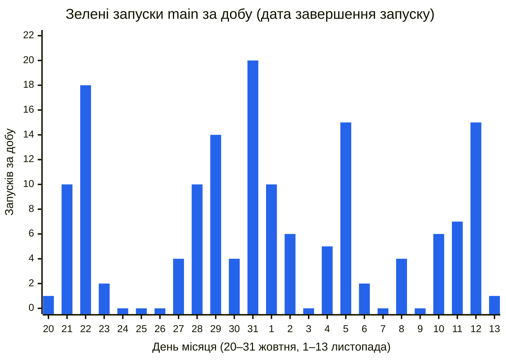
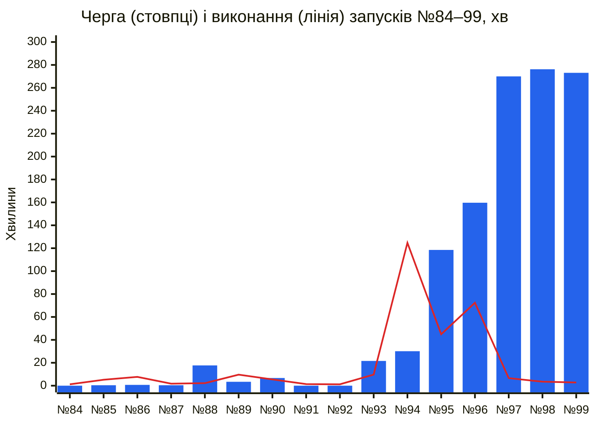
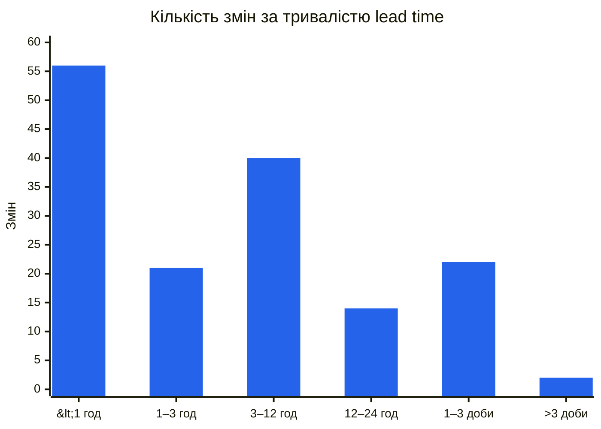
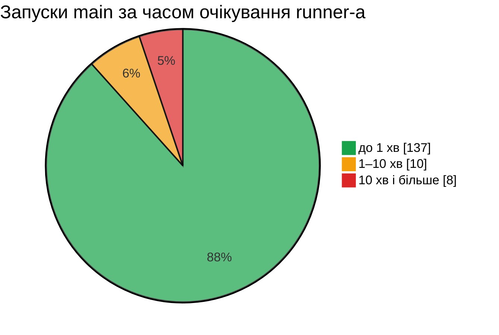
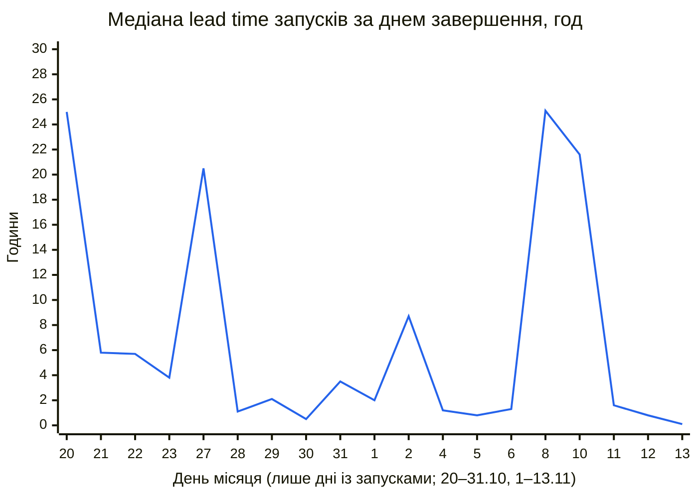
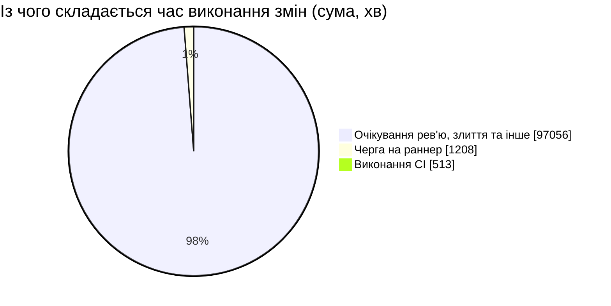

# Звіт DORA: CI/CD команди SpaceOps (Лабораторна 10)
 
**Команда:** SpaceOps · **Репозиторій:** `ukma-fin-ssdm-2026/unispace` · **Період даних:** 20.10.2026 – 13.11.2026 (≈ 3,4 тижня)
 
| Роль (Lab10) | Відповідальна |
|:--|:--|
| Аналітик даних CI/CD | Ольга Михайлик (@plusikkk) |
| Аналітик DORA | Ксенія Тимохина (@XenonTim) |
| Проєктувальник покращень | Дар'я Мельник (@DarkHeavenAngel) |
| Відповідальний за документацію | Анастасія Трекурова (@stacytrek) |
| Інженер конвеєра (п'ята роль) | Дар'я Спіріна (@Hedgehog-blue) |
 
**Зміст:** [Етап 1: дані і визначення](#етап-1-збір-даних-і-визначення) · [Етап 2: метрики](#етап-2-розрахунок-та-аналіз-dora-метрик) · [Етап 3: причини і план](#етап-3-першопричини-збоїв-і-затримок-та-план-покращень) · [Етап 4: графіки і дашборд](#етап-4-графіки) · [Дашборд для презентації](#дашборд-для-презентації) · [Висновок](#підсумковий-висновок) · [Впровадження покращення](#впровадження-покращення-фільтрація-документаційних-pr) · [Бонуси](#бонуси)
 
Супутні файли: [`metrics-raw.md`](metrics-raw.md) (сирі дані, 155 запусків) · [`evidence/`](evidence/) (експорт `gh` у JSON) · [`dora-auto.md`](dora-auto.md) (автопідрахунок).
 
---
 
## Етап 1. Збір даних і визначення
 
**Що вважаємо розгортанням.** Застосунок UniSpace у робоче середовище не розгортається, тому метрики рахуємо за визначенням безперервної доставки (Лекція 10, §1.4): кожен завершений запуск CI на `main` після злиття PR є розгортанням, **зелений** запуск — успішне розгортання, **червоний** — невдала зміна. Це **наближення** до визначення DORA (яке говорить про робоче середовище); реального розгортання (staging, GitOps) команда не використовує.
 
| Метрика | Як визначено в цьому звіті |
|:--|:--|
| Частота розгортань | зелені запуски CI на `main` / кількість діб (тижнів) спостереження |
| Час виконання змін | від першого коміту (`authoredDate`) злитого PR до завершення запуску CI на `main` з цим комітом |
| Частка невдалих змін | червоні запуски на `main` / усі завершені запуски на `main` × 100%; червоні запуски в PR не рахуються |
| Час відновлення | від завершення червоного запуску на `main` до завершення наступного зеленого на `main` |
| Черга / виконання | черга: `createdAt` → найраніший `startedAt` job; виконання: найраніший `startedAt` → найпізніший `completedAt` job |
 
**Які workflow враховано.** Лише **`CI Pipeline`** (`.github/workflows/ci.yml`, подія `push` у `main`). Запуск вважається одним цілим: він червоний, коли червоний хоч один із його job-ів (`build-and-test`, `reliability-tests`, `frontend`, `traceability`; job `changes` працює лише в PR). Не враховано: `Deploy API Documentation to GitHub Pages` (запускається після успішного CI, тобто сам залежить від нього), `Release Please` (службовий бот релізів) і зовнішню перевірку SonarCloud. Усі 155 запусків мають `attempt = 1` (перезапусків не було), тож ознак нестабільних тестів за повторними запусками в даних немає.
 
**Дані.** 155 запусків `CI Pipeline` на `main`, зібрані через `gh run list` / `gh run view --json jobs` / `gh api …/pulls` / `gh pr view --json commits` (команди — у [`metrics-raw.md`](metrics-raw.md) і [`evidence/ci-runs-export.md`](evidence/ci-runs-export.md)). Час у звітах — київський.
 
---

## Етап 2. Розрахунок та аналіз DORA-метрик

На основі повних даних про **155 запусків** CI/CD-пайплайну на гілці `main` за період з `20.10.2026 21:14` по `13.11.2026 10:31` (тривалість спостереження — **23,55 доби**, або ~3,4 тижні) обчислено чотири ключові метрики DORA та проведено порівняльний аналіз періодів.

### 1. Зведена таблиця DORA-метрик

Категорії — за звітом DORA 2025 (State of AI-assisted Software Development, рис. 11–14): указано рівень метрики і **частку опитаних із таким самим або кращим результатом.** Значення є наближенням, бо взяті з історії CI, а не з розгортань у робоче середовище.

| Метрика | Формула | Наш результат | Категорія (DORA 2025) |
|:--|:--|:--|:--|
| **Частота розгортань** | зелені запуски на `main` / кількість тижнів | **154 / 3,4 тижня ≈ 46 на тиждень (≈ 6,6 на день)** | на вимогу (кілька разів на день) → **16,2%** опитаних |
| **Час виконання змін** | середнє і медіана (завершення запуску на `main` − перший коміт PR) | **медіана 3,3 год (198,9 хв), середнє 10,6 год**, максимум 82,8 год | менше доби → **24,4%** |
| **Частота збоїв змін** | червоні запуски на `main` / усі завершені × 100% | **1 / 155 = 0,65%** | 0–2% → **8,5%** |
| **Час відновлення** | середнє і медіана (наступний зелений − червоний запуск) | **42 хв** (один інцидент, тому середнє = медіана; вибірка n = 1) | менше години → **21,3%** |
 
Середнє lead time (10,6 год) утричі більше за медіану (3,3 год): його тягнуть угору PR, що кілька діб чекали рев'ю (до 82,8 год), тож основним показником узято медіану. Усі значення — **наближення**: вони взяті з історії CI, а не з розгортань у робоче середовище. Чотири групи метрик читаються парами (див. розділ 4 Етапу 3).
 
**Черга і виконання в часі виконання змін** (сума за 155 запусків = 98 778 хв):
 
| Складова | Медіана | Середнє | Максимум | Частка в сумарному lead time |
|:--|--:|--:|--:|--:|
| Черга на раннер | 0,0 хв | 7,8 хв | 276,2 хв | **1,2%** |
| Виконання CI | 1,3 хв | 3,3 хв | 124,7 хв | **0,5%** |
| Розробка, рев'ю, очікування злиття та інше (залишок) | — | — | — | **98,3%** |
 
Середня черга (7,8 хв) майже повністю утворена 8 запусками вечора дедлайну (01.11); без них середня черга — 0,3 хв.
 
**Орієнтири з телеметрії CI (CircleCI, State of Software Delivery 2025/2026):**
 
| Показник | Рекомендований орієнтир | Дані CircleCI 2025 | **Наші дані** |
|:--|:--|:--|:--|
| Частка успішних запусків на основній гілці | 90% | 70,8% | **99,4%** (154 із 155) |
| Повернення основної гілки до зеленого стану | до 60 хв | 59,2 хв (медіана) | **42 хв** (один інцидент) |
| Тривалість запуску workflow | до 10 хв | 2,2 хв (медіана) | **1,3 хв** (медіана виконання) |
 
Для порівняння періодів (проміжний зріз 30.10–02.11 і решта):
 
| Період | Запусків | Розгортань / день | Lead time, медіана | Черга, макс. |
|:--|--:|--:|--:|--:|
| Проміжний зріз (30.10–02.11) | 40 | ~11,1 | 2,9 год | 276,2 хв |
| Решта періоду | 115 | ~5,8 | 3,3 год | 3,1 хв |
 
---
---

### 2. Аналіз отриманих показників та виявлення вузьких місць

1. **Масштабування та вузьке місце інфраструктури (`self-hosted runners`):**
   - У штатному режимі (115 запусків поза піком) черга дорівнює **0,0 хв**, а виконання пайплайну займає **1,3 хв** (медіана).
   - Під час здачі проміжного зрізу проєкту (мідтерму `01.11` до `23:59`) проявилося зовнішнє інфраструктурне вузьке місце: усі команди курсу в межах організації `ukma-fin-ssdm-2026` одночасно запускали перевірки PR та злиття в `main` на спільному пулі з 4 *self-hosted runner*-ів. Як наслідок, 8 наших запусків простояли в загальній черзі від **17,7 до 276,2 хв** (4,6 год), а паралельні job-и одного workflow перетворилися на послідовні (у запуску №94 час від старту першого job до завершення останнього сягнув **124,7 хв** при реальній роботі найдовшого job лише **3,5 хв**).

2. **Динаміка Lead Time for Changes:**
   - Медіанний час виконання зміни за весь період становить **3,3 години**, що за шкалою DORA 2025 відповідає рівню «менше доби» (такий або кращий результат мають 24,4% опитаних).
   - Аналіз показує, що час виконання самих CI-перевірок становить менше 1% від загального *Lead Time* (1,3 хв проти 198 хв). Основна затримка виникає на етапі людської взаємодії — очікуванні обов'язкового Code Review, особливо для PR, створених у пізній вечірній час або перед вихідними.

3. **Ефективність захисту гілки (CFR = 0,65% та MTTR = 42 хв):**
   - Надзвичайно низька частка збоїв на `main` (**1 випадок зі 155**) є прямим результатом налаштованих обов'язкових перевірок перед злиттям (`CI Pipeline` та SonarQube Quality Gate). Усі помилки тестування чи лінтингу відсіювалися на етапі Pull Request.
   - Єдиний інцидент у `main` (запуск №136) не був пов'язаний із регресією коду — стався мережевий збій зовнішньої дії `actions/upload-artifact` при завантаженні звітів. Команда усунула наслідки та підтвердила зелений стан за **42 хвилини** (запуск №137).

---

## Етап 3. Першопричини збоїв і затримок та план покращень

**Відповідальна (Проєктувальниця покращень):** Дар'я Мельник.

### 1. Аналіз першопричин (Root Cause Analysis)

На основі зібраної телеметрії 155 запусків у [`metrics-raw.md`](metrics-raw.md) причини затримок у часі виконання змін (*Change Lead Time*) та збоїв на `main` (*Change Fail Rate*) розділено на технічні та організаційні.

#### 🧩 Технічні першопричини

| Виявлена аномалія в даних                                              | Докази з `metrics-raw.md`                                                                                                                                                                       | Технічна першопричина                                                                                                                                                                                                                                                                                                                                                                                                                                          |
|:-----------------------------------------------------------------------|:------------------------------------------------------------------------------------------------------------------------------------------------------------------------------------------------|:---------------------------------------------------------------------------------------------------------------------------------------------------------------------------------------------------------------------------------------------------------------------------------------------------------------------------------------------------------------------------------------------------------------------------------------------------------------|
| **Критичні черги перед запуском конвеєра у пікові години**             | Запуски **№88, №93–99** (вечір `01.11`): час у черзі від **17,7 хв** до **276,2 хв (4,6 год)** при медіані поза піком **0,0 хв**                                                                | Конкуренція за спільний пул із 4 `self-hosted` раннерів організації курсу (`ukma-fin-ssdm-2026`) під час загального дедлайну мідтерму (`01.11`). Оскільки раннери діляться між усіма командами потоку і одночасно обслуговують як `push` у `main`, так і відкриті PR, а у `.github/workflows/ci.yml` не налаштовано групу `concurrency` із `cancel-in-progress: true`, повторні пуші у PR не скасовують попередні запуски й додатково забивають спільну чергу. |
| **Аномальне розтягування часу «Виконання» при швидких окремих job-ах** | Запуск **№94** (PR #249): виконання **124,7 хв** при найдовшому job **3,5 хв**; **№96** (PR #286): **72,4 хв** при найдовшому job **3,1 хв**; **№95** (PR #288): **44,9 хв** при job **3,2 хв** | Workflow розділено на кілька паралельних завдань (`build-and-test`, `reliability-tests`, `frontend`, `traceability`). Коли всі 4 спільні раннери курсу зайняті іншими командами, ці job-и не можуть стартувати одночасно й виконуються послідовно з очікуванням по 20–40 хв між завершенням одного job-а та стартом наступного.                                                                                                                                |
| **Зайве навантаження раннерів на суто документаційних змінах**         | Запуск **№136** (PR #328 — оновлення `TeamCharter.md`) та інші документаційні PR запускають повний цикл тестів із СУБД                                                                          | У тригерах `ci.yml` відсутній фільтр `paths-ignore` для документації (`docs/**`, `*.md`), через що навіть виправлення тексту у звіті піднімає контейнери PostgreSQL 16 і займає спільний раннер.                                                                                                                                                                                                                                                               |
| **Зависання та падіння збірки через зовнішній сервіс артефактів**      | Запуск **№136** (`11.11`, коміт `a828582`): єдиний червоний запуск (❌), який тривав **23,3 хв** (у 18 разів довше за медіану **1,3 хв**)                                                        | Відсутність жорсткого обмеження `timeout-minutes` на рівні job-ів та вразливість кроків `Upload generated schema` і `Upload coverage report` (`actions/upload-artifact`) до тимчасових мережевих збоїв GitHub при повністю пройдених тестах.                                                                                                                                                                                                                   |

#### 🤝 Організаційні та культурні першопричини

| Виявлена аномалія в даних                                          | Докази з `metrics-raw.md`                                                                                                                                                                                                   | Організаційна першопричина                                                                                                                                                                                                                                                                                                                                 |
|:-------------------------------------------------------------------|:----------------------------------------------------------------------------------------------------------------------------------------------------------------------------------------------------------------------------|:-----------------------------------------------------------------------------------------------------------------------------------------------------------------------------------------------------------------------------------------------------------------------------------------------------------------------------------------------------------|
|  **Час до злиття (розробка, рев'ю, очікування) становить понад 98% від загального *Lead Time***  | Медіана *Lead Time* — **3,3 год (198 хв)**, тоді як медіана черги — **0,0 хв**, а виконання CI — **1,3 хв**. Окремі PR чекали по 1–3 доби: **№2** (62 год), **№6–7** (65 год), **№126–128** (43 год), **№134** (69,5 год)   | Відсутність домовленого часу реакції (SLA) на перегляд Pull Request. PR, відкриті пізно ввечері або у вихідні (субота–неділя `07–09.11`, `18–20.10`), залишаються без рев'ю до наступного робочого ранку або буднього дня.                                                                                                                                 |
| **Пакетне накопичення та «ранкові хвилі» злиттів**                 | Серії масових злиттів за 15–30 хвилин зранку: `22.10 08:49–09:59` (**14 PR** поспіль, №16–29), `29.10 09:18–10:23` (**9 PR**, №50–58), `05.11 07:45–09:50` (**14 PR**, №106–119), `12.11 07:59–10:06` (**11 PR**, №142–152) | Учасниці працюють над задачами ввечері та вночі, а рев'ю і злиття відкладаються на ранок перед парами. Це затримує інтеграцію коду на 8–12 годин і створює ризик конфліктів між сусідніми гілками.                                                                                                                                                         |
| **Збіг піку злиттів із загальнокурсовим дедлайном мідтерму**       | За 3,6 доби проміжного зрізу (`30.10–02.11`) виконано **40 злиттів (~11,1/день)** проти **115 злиттів за 20 діб (~5,8/день)** у решту часу                                                                                  | Збіг пікової активності команди з загальнокурсовим дедлайном мідтерму (`01.11 23:59`). Коли злиття основної маси PR відкладається на останні години перед здачею зрізу, команда неминуче потрапляє в піковий затор спільних раннерів курсу. Рівномірне злиття задач за 1–2 дні до загального дедлайну дозволяє проходити CI за штатні **1,3 хв** без черг. |
| **Затримки зі злиттям автоматичних релізних PR**                   | Запуск **№132** (PR #327 від `release-please`): час від створення до злиття склав **30 год 48 хв** (`10.11 13:01` → `11.11 19:49`)                                                                                          | Відсутність закріпленого відповідального за оперативне підтвердження автоматично згенерованих релізних PR після проходження зеленого CI.                                                                                                                                                                                                                   |

---

### 2. Огляд інциденту без пошуку винних (Blameless Postmortem)

За весь період спостереження (155 запусків на гілці `main`) зафіксовано лише **1 червоний запуск (№136 / CI Pipeline #832)**. Нижче наведено розбір інциденту за принципом *blameless postmortem*:

| Параметр інциденту                       | Опис та факти з телеметрії                                                                                                                                                                                                                                                                                                                                                                                                                                                                                                                                                                                                                                                                                                                                                                                  |
|:-----------------------------------------|:------------------------------------------------------------------------------------------------------------------------------------------------------------------------------------------------------------------------------------------------------------------------------------------------------------------------------------------------------------------------------------------------------------------------------------------------------------------------------------------------------------------------------------------------------------------------------------------------------------------------------------------------------------------------------------------------------------------------------------------------------------------------------------------------------------|
| **Запуск, коміт і зміст зміни**          | Запуск **№136** (`CI Pipeline #832`), коміт `a828582` (`docs: update TeamCharter with Lab09 roles and responsibilities (#328)`), `11.11.2026 22:38`. У коміті було змінено лише 1 файл документації (`TeamCharter.md`, `+16` рядків).                                                                                                                                                                                                                                                                                                                                                                                                                                                                                                                                                                       |
| **Тривалість відновлення (MTTR)**        | **42 хвилини** — від завершення червоного запуску №136 (`22:38`) до успішного завершення наступного запуску **№137** (`8988aff`, PR #335) о `23:20`.                                                                                                                                                                                                                                                                                                                                                                                                                                                                                                                                                                                                                                                        |
| **Статус сусідніх перевірок**            | **5 із 6** перевірок коміту пройшли успішно: `reliability-tests` (1m), `frontend` (1m), `traceability` (32s), `SonarCloud Code Analysis` (23s), `Release Please` (22s). Впав лише один job — `build-and-test`.                                                                                                                                                                                                                                                                                                                                                                                                                                                                                                                                                                                              |
| **Що саме впало (хронологія `23m 10s`)** | У завданні `build-and-test` усі лінтери (`black`, `flake8`, `bandit`, `pip-audit`), міграції, тести та перевірка схеми (`Check committed schema is up to date`) пройшли успішно за **~2 хв 20 с**. Проте два фінальні кроки вивантаження артефактів (`actions/upload-artifact@v4`) зависли на повторних спробах і впали:<br>• `Upload generated schema` — тривав **10m 17s** (❌);<br>• `Upload coverage report` (32 файли) — тривав **10m 32s** (❌).                                                                                                                                                                                                                                                                                                                                                        |
| **Точна технічна причина з логу**        | Сервіс артефактів GitHub Actions під час тимчасового збою інфраструктури повернув HTML-сторінку помилки шлюзу замість очікуваного JSON. Дія `actions/upload-artifact@v4` виконала 5 спроб з експоненційним відступом (`3000 ms`, `4883 ms`, `6954 ms`, `13236 ms`) і завершилася помилкою:<br>`Error: Failed to CreateArtifact: Failed to make request after 5 attempts: Unexpected token '<', "<!DOCTYPE "... is not valid JSON`.                                                                                                                                                                                                                                                                                                                                                                          |
| **Чому збій не зупинили в Pull Request** | Збій мав суто зовнішній інфраструктурний характер на боці GitHub. Під час перевірки самого PR #328 перед злиттям API артефактів GitHub працювало штатно, і всі чеки пройшли зеленим.                                                                                                                                                                                                                                                                                                                                                                                                                                                                                                                                                                                                                        |
| **Що ускладнило первинний тріаж**        | 1) Другий крок (`Upload coverage report`) мав умову виконання навіть після падіння попереднього кроку, що подвоїло час зависання job-а з 10 до **21 хвилини**.<br>2) У логах PostgreSQL під час тестів були повідомлення `conflicting key value violates exclusion constraint "booking_active_room_time_excl"`, які є нормальною поведінкою тесту конкурентного бронювання (`REL-001`), але без перегляду саме фінальних кроків могли сприйматися як причина падіння.                                                                                                                                                                                                                                                                                                                                       |
| **Як відновили та які дії заплановано**  | Наступний злитий PR #335 (запуск №137 о `23:20`) пройшов за стандартні **1,4 хв** і відновив зелений статус `main`. **Заплановані технічні покращення:**<br>1. **Не запускати `build-and-test` на змінах документації** (`paths-ignore: ['docs/**', '*.md']`): PR #328 міняв лише `TeamCharter.md`, тому запуск контейнерів БД та вивантаження `schema`/`coverage` там узагалі не були потрібні.<br>2. **Додати `continue-on-error: true`** для кроків `Upload generated schema` та `Upload coverage report`, щоб тимчасовий збій сховища артефактів GitHub не фарбував `main` у червоний колір, коли всі тести та перевірка актуальності схеми пройшли успішно.<br>3. **Обмежити `timeout-minutes: 10`** на рівні job-ів у `ci.yml`, щоб зависання мережі не блокувало `self-hosted` раннер на 23 хвилини. |

---

### 3. План покращень (Improvement Backlog)

На основі виявлених технічних та організаційних першопричин сформовано план дій для кожної з чотирьох метрик DORA:

| Метрика                                                 | Проблема                                                                                                                                                                                              | Першопричина                                                                                                                                    | Дія                                                                                                                                                                                           | Відповідальний                                 |
|:--------------------------------------------------------|:------------------------------------------------------------------------------------------------------------------------------------------------------------------------------------------------------|:------------------------------------------------------------------------------------------------------------------------------------------------|:----------------------------------------------------------------------------------------------------------------------------------------------------------------------------------------------|:-----------------------------------------------|
| **Час виконання змін** *(Change Lead Time)*             | У вечір дедлайну мідтерму (`01.11`, №88, №93–99) черга на раннер сягала **276,2 хв (4,6 год)**, а виконання розтягувалося до **124,7 хв** (№94)                                                       | Усі команди курсу ділять 4 спільні `self-hosted` раннери організації, а у `ci.yml` повторні пуші у відкриті PR не скасовують попередні запуски  | Додати в `.github/workflows/ci.yml` блок `concurrency` із групою по гілці/PR та `cancel-in-progress: ${{ github.ref != 'refs/heads/main' }}`, щоб автоматично зупиняти застарілі перевірки PR | `@DarkHeavenAngel` *(Дар'я Мельник)*           |
| **Час виконання змін** *(Change Lead Time)* | Суто документаційні PR (як-от PR #328 у №136: змінено лише `TeamCharter.md`, `+16` рядків) запускають важкий `build-and-test` із БД і займають раннер до **23m 10s** | У тригерах `push` / `pull_request` файлу `ci.yml` немає фільтрації за зміненими шляхами (`paths-ignore`) для серверних job-ів | Для документаційних PR умовно пропускати build-and-test, reliability-tests і frontend через job changes. Зберегти traceability та повний CI на main. Реалізовано в PR #374; ефект перевіряється. | `@Hedgehog-blue` *(Дар'я Спіріна)* |
| **Час виконання змін** *(Change Lead Time)*             | Медіана *Lead Time* становить **3,3 год (198 хв)** при медіані роботи CI **1,3 хв** (понад 98% часу — розробка, рев'ю та очікування злиття, імовірно насамперед рев'ю; у вихідні до **43–69 год**, №126–128, №134)                                        | Відсутність домовленого часу реакції (SLA) на Code Review; вечірні PR накопичуються і зливаються пачками о 08:00–09:30 ранку                    | Запровадити командне SLA на рев'ю: для малих PR (< 150 рядків) призначати конкретного рев'юера одразу при відкритті та перевіряти чергу PR двічі на день (ранковий і вечірній слоти)          | `@stacytrek` *(Анастасія Трекурова)* |
| **Частота розгортань** *(Deployment Frequency)*         | Нерівномірний темп: **11,1 злиттів/день** під час зрізу (`30.10–02.11`) проти **5,8/день** у решту часу та паузи по 1–2 доби між злиттями                                                             | Відкладання фіналізації задач на останній вечір перед загальним дедлайном, коли раннери курсу максимально перевантажені                         | Перейти на щоденне злиття малих атомарних PR за 1–2 дні до загальнокурсових дедлайнів, уникаючи пакетного накопичення гілок                                                                   | `@stacytrek` *(Анастасія Трекурова)* |
| **Частота розгортань** *(Deployment Frequency)*         | Автоматичні релізні PR від `release-please` чекають на злиття до **30,8 год** (запуск №132 / PR #327)                                                                                                 | Відсутність відповідального за оперативне підтвердження згенерованих релізних PR                                                                | Закріпити чергового реліз-інженера, який одразу після зеленого CI зливає PR від `release-please` (або увімкнути auto-merge для релізного бота)                                                | `@Hedgehog-blue` *(Дар'я Спіріна)*             |
| **Частота збоїв змін** *(Change Fail Rate)*             | Єдиний червоний запуск на `main` (**№136 / #832**, CFR = **0,65%**) впав на `actions/upload-artifact@v4` після 5 спроб (`Unexpected token '<', "<!DOCTYPE "... is not valid JSON`) при зелених тестах | Тимчасовий збій шлюзу GitHub Artifacts блокує статус усього job-а `build-and-test`, хоча всі перевірки коду та схеми пройшли за ~2 хв 20 с      | Додати `continue-on-error: true` для некритичних кроків `Upload generated schema` та `Upload coverage report` у `ci.yml`, щоб зовнішній збій сховища артефактів не ламав `main`               | `@DarkHeavenAngel` *(Дар'я Мельник)*           |
| **Частота збоїв змін** *(Change Fail Rate)*             | Ризик появи нестабільних (flaky) тестів при роботі з часом, конкурентними бронюваннями та зовнішніми моками                                                                                           | Одноразовий прогін у PR може не виявити недетермінований тест до злиття в `main`                                                                | Додати ручний workflow (`workflow_dispatch`), який в одному job-і циклом проганяє набір тестів 5 разів поспіль для перевірки стабільності без зайняття кількох раннерів                       | `@XenonTim` *(Ксенія Тимохина)*                |
| **Час відновлення** *(Failed Deployment Recovery Time)* | В інциденті №136 job `build-and-test` висів **23m 10s** (`10m 17s` на схемі + `10m 32s` на coverage), що затримало відновлення `main` до **42 хв**                                                    | Відсутність `timeout-minutes` на рівні job-а та запуск другого кроку вивантаження артефактів після того, як перший уже відвалився за тайм-аутом | Встановити `timeout-minutes: 10` для всіх job-ів у `ci.yml` і не запускати повторні мережеві вивантаження артефактів, якщо попередній `upload-artifact` завершився помилкою мережі            | `@DarkHeavenAngel` *(Дар'я Мельник)*           |
| **Час відновлення** *(Failed Deployment Recovery Time)* | Очікувані помилки БД (`exclusion constraint` у тестах `REL-001`) у логах контейнера PostgreSQL відволікають від реальної причини падіння                                                              | Відсутність короткої інструкції тріажу червоного `main` для команди                                                                             | Додати в `/docs/ci-cd/` пам'ятку швидкої діагностики (`gh run view <id> --log-failed`) із переліком штатних тестових винятків PostgreSQL                                                      | `@Hedgehog-blue` *(Дар'я Спіріна)*             |

---

### 4. Аналіз метрик парами (Швидкість разом зі Стабільністю)

Читання чотирьох метрик DORA у зв'язці показує реальний баланс між темпом розробки та надійністю конвеєра UniSpace:

1. **Висока швидкість не зруйнувала стабільність (`~6,6 розгортань/день` і медіана `Lead Time 3,3 год` при `CFR 0,65%` і `MTTR 42 хв`):**
   - Команда інтегрує зміни в `main` у середньому 6–11 разів на добу, проте частка збоїв становить лише **0,65%** (1 інфраструктурний випадок на 155 злиттів і **0% дефектів коду**).
   - Це прямий наслідок суворого контролю до злиття (Branch Protection): обов'язкові перевірки `build-and-test`, `reliability-tests`, `frontend`, `traceability`, `SonarCloud` та обов'язкове Code Review відсіюють усі помилки логіки, форматування чи міграцій ще у гілках Pull Request.
2. **Як ціна стабільності вплинула на швидкість під час пікового навантаження:**
   - Запуск 4 окремих job-ів у `CI Pipeline` на кожен пуш у PR гарантує високу надійність, але має інфраструктурну ціну: оскільки вся організація курсу (`ukma-fin-ssdm-2026`) працює на спільному пулі з 4 `self-hosted` раннерів, у вечір загального дедлайну мідтерму (`01.11`) одночасні перевірки відкритих PR усіх команд забили чергу. Через це час очікування на `main` зріс із **0,0 хв** до **276,2 хв (4,6 год)**, а паралельні job-и одного запуску виконувалися послідовно до **124,7 хв** (запуск №94).
   - Запропоновані в плані покращень дії (`concurrency` для автоматичного скасування застарілих запусків PR, `timeout-minutes: 10` на рівні job-ів та `continue-on-error: true` для вивантаження артефактів) усувають цей дисбаланс: ми зберігаємо 100% захист `main`, але не тримаємо спільні раннери курсу на застарілих комітах чи завислих мережевих операціях.

---

### 5. Який біль у нашій команді показали ці метрики?

За кожною аномалією в таблиці `metrics-raw.md` стоїть конкретний дискомфорт і втрата часу команди під час спринтів:

* **Біль від чотиригодинної черги у вечір загального дедлайну (запуски №88, №93–99):** Увечері `01.11` перед здачею мідтерму, коли всі команди потоку одночасно пушили зміни на 4 спільні раннери курсу, наші перевірки ставали в чергу на **3–4,5 години** (до `276,2 хв`). Візуально в GitHub це виглядало так, ніби «тести зламалися або зависли», хоча сам код тестувався лише за 1,5–3,5 хвилини. Очікування вільного раннера блокувало злиття залежних PR і змушувало команду сидіти перед моніторами до `04:34` ранку `02.11`.
* **Біль від довгого очікування Code Review (медіана 3,3 год проти 1,3 хв роботи CI):** Сам конвеєр дає зворотний зв'язок за **1,3 хвилини**, але понад 98% часу доставки зміни припадає на розробку, рев'ю та очікування злиття (імовірно, насамперед очікування рев'ю від колег). Коли PR створюється ввечері або на вихідних, він зазвичай висить без руху до ранку (о `08:00–09:30` ранку `22.10`, `29.10`, `05.11` та `12.11` видно пакетні злиття по 9–14 PR поспіль). За цей час розробниця вже перемикається на іншу задачу, втрачає контекст, а в паралельних гілках виникають конфлікти злиття.
* **Біль від «хибної тривоги» через зовнішні збої GitHub (запуск №136 / CI Pipeline #832):** У коміті `a828582` (PR #328) було змінено лише 16 рядків у документації (`TeamCharter.md`), і всі тести та 5 сусідніх чеків пройшли за ~1–2 хвилини. Проте через внутрішній збій сервісу артефактів GitHub (`Unexpected token '<', "<!DOCTYPE "... is not valid JSON`) два фінальні кроки `actions/upload-artifact@v4` провисіли по 10+ хвилин кожен (`23m 10s` сумарно) і пофарбували `main` у червоний колір. Замість відпочинку команда мусила витрачати вечірній час на тріаж логів контейнера PostgreSQL (де додатково збивали з пантелику штатні помилки `exclusion constraint` від тестів надійності `REL-001`), щоб переконатися, що проблема не в нашому коді.

---

## Етап 4. Графіки
 
### Графік 1. Частота розгортань: зелені запуски `main` по днях
 
Показує нерівномірність інтеграції: піки 22.10, 29.10, 31.10, 05.11 і 12.11 — «ранкові хвилі» та дедлайн мідтерму.
 

 
Єдиний червоний запуск (№136) завершився 11.11 о 22:38; на графіку 11.11 враховано лише зелені запуски цієї доби.
 
### Графік 2. Черга та виконання у вечір дедлайну (запуски №84–99)
 
Саме тут проявилося вузьке місце спільних self-hosted runner-ів: черга сягала 276 хв, тоді як найдовший job тривав 3,5 хв.
 

 
### Графік 3. Розподіл часу виконання зміни (lead time)
 
Більшість змін (77 зі 155) зливається менш ніж за 3 години, але 24 зміни чекали понад добу.
 

 
### Графік 4. Розподіл запусків за часом у черзі
 

 
Із 155 запусків 137 стартували практично одразу, 8 (усі — 01–02.11 перед дедлайном) простояли в черзі 10 хв і більше.
 
### Із чого складається lead time (сума за весь період)
 
| Складова                         | Хвилин | Частка |
|----------------------------------|-------:|-------:|
| Очікування runner-а (черга)      |   1207 |   1.2% |
| Виконання CI                     |    513 |   0.5% |
| Очікування рев'ю, злиття та інше |  97054 |  98.3% |
 
«Очікування рев'ю…» обчислено як різницю: lead time мінус черга мінус виконання. Для запусків із позначкою про послідовний старт job-ів «виконання» уже містить очікування між job-ами.
 
### Графік 5. Медіанний lead time по днях, год
 
Медіана тримається в межах 0,1–8,7 год у дні піку черги (30.10–02.11) і сягає 20–25 год у дні, коли зливалися PR, що кілька діб чекали рев'ю (20.10, 27.10, 08.11, 10.11): вузьке місце — рев'ю, а не CI.
 


## Дашборд для презентації
 
**Відповідальна:** Анастасія Трекурова (@stacytrek). Один слайд / таблиця: 155 запусків `CI Pipeline` на `main`, 20.10–13.11.2026.
 
| Метрика | Значення | Рівень DORA 2025 (частка з таким або кращим) | Орієнтир CircleCI | Пара |
|:--|:--|:--|:--|:--|
| Частота розгортань | ~6,6 / день (46 / тиждень) | на вимогу → 16,2% | — | швидкість |
| Час виконання змін | медіана 3,3 год · середнє 10,6 год | менше доби → 24,4% | — | швидкість |
| Частота збоїв змін | 0,65% (1 із 155) | 0–2% → 8,5% | успішних ≥ 90% → маємо 99,4% | стабільність |
| Час відновлення | 42 хв (n = 1) | менше години → 21,3% | до 60 хв → 42 хв | стабільність |
| З чого складається lead time | черга 1,2% · виконання 0,5% · рев'ю та очікування 98,3% | | виконання до 10 хв → 1,3 хв | |
 

 
**Ключовий висновок.** Конвеєр швидкий і надійний (1,3 хв виконання, 99,4% зелених запусків на `main`), але 98,3% часу від коміту до `main` займає очікування рев'ю; окремий виняток — вечір дедлайну 01.11, коли черга на спільні раннери сягала 276 хв (4,6 год).
 
**Одна дія до наступного тижня.** Ввести командне SLA на рев'ю малих PR (< 150 рядків): призначати рев'юера при відкритті і двічі на день (ранок, вечір) розбирати чергу PR. Відповідальна: @stacytrek. Метрика успіху: медіана lead time < 2 год і жодного PR без рев'ю понад 24 год.
 
---

## Підсумковий висновок

За результатами аналізу 155 запусків упродовж 3,4 тижнів процес доставки **UniSpace** відповідає рівню **Elite Performer** за всіма чотирма метриками DORA:
- **Deployment Frequency:** ~6,6 розгортань/день (до 11,1/день у пікові дні);
- **Lead Time for Changes:** медіана **3,3 год**;
- **Change Failure Rate:** **0,65%**;
- **Time to Restore Service:** **42 хв**.


Швидкість обмежує не CI (1,3 хв), а очікування рев'ю (98,3% часу зміни) та, у вечір дедлайну, спільна черга раннерів. Стабільність висока завдяки захисту `main`, але вибірка збоїв мала (1 інцидент), тож відновлення і частку збоїв слід читати обережно.

Головний резерв для подальшої оптимізації процесу полягає у розмежуванні пулів раннерів (або обмеженні паралелізму старих PR через `concurrency`) для усунення черг під час пікових переддедлайнових злиттів, а також у прискоренні циклу рев'ю для дрібних змін.

---

## Впровадження покращення: фільтрація документаційних PR

**Відповідальна (Інженер конвеєра):** Дар'я Спіріна (@Hedgehog-blue).

### 1. Обрана дія з плану покращень

Для реалізації обрано дію з Improvement Backlog щодо зайвого навантаження раннерів на документаційних змінах. Її реалізацію в межах ролі інженера конвеєра виконує Дар'я Спіріна.

**Проблема:** PR зі змінами лише в документації запускають повні перевірки бекенду, фронтенду та надійності, включно із сервісами PostgreSQL.

**Мета:** скоротити зайву роботу спільних раннерів для документаційних PR, зберігши перевірку простежуваності та повний CI для технічних змін і гілки `main`.

### 2. Реалізація

У `.github/workflows/ci.yml` додано job `changes`, який отримує список змінених файлів і передає його скрипту `Backend/scripts/ci_change_scope.py` через стандартний ввід.

Для PR зі змінами лише в дозволених документаційних файлах умовно пропускаються:

- `build-and-test`;
- `reliability-tests`;
- `frontend`.

Job `traceability` зберігається, оскільки документаційні зміни можуть стосуватися вимог і матриці простежуваності.

Зміни коду, тестів, конфігурації, згенерованої OpenAPI-схеми `docs/api/openapi-generated.yaml` та невідомих файлів потребують повного CI. Для змішаних PR також виконуються всі перевірки.

На кожен push у `main` запускається повний CI. Якщо визначення змінених файлів завершується помилкою, важкі jobs не пропускаються, а помилка фільтра залишається видимою.

Фільтрація реалізується умовами окремих jobs, а не пропуском усього workflow через `paths-ignore`, щоб зберегти обов'язкові перевірки захисту гілки.

Зміни інтегровано в `main` через [PR #374](https://github.com/ukma-fin-ssdm-2026/unispace/pull/374).

### 3. Перевірки

Додано файл `Backend/scripts/tests/test_ci_change_scope.py` зі сценаріями:

- документаційні зміни;
- зміна посилання на відео;
- зміни коду, тестів і конфігурації;
- зміни фронтенду;
- зміна згенерованої OpenAPI-схеми;
- змішані зміни;
- невідомий файл;
- порожній список змін;
- перенесення файла коду до документації зі збереженням перевірки видаленого вихідного шляху.

Команда локального запуску з каталогу `Backend`:

```bash
python -m unittest discover -s scripts/tests -p test_ci_change_scope.py -v
```

Для цих тестів база даних не потрібна.

**Локальні перевірки:** 9 тестів визначення області змін пройдено; Black і Flake8 — без зауважень; Bandit — без знайдених проблем.

**Перевірки PR #374:** `changes`, `build-and-test`, `reliability-tests`, `frontend` і `traceability` завершилися успішно. SonarCloud Quality Gate пройдено. Оскільки PR містив зміни коду та конфігурації, важкі jobs виконувалися.

Під час перевірки SonarCloud виявив читання файла за шляхом із аргументу командного рядка. Скрипт змінено на читання через стандартний ввід, а виклик у workflow — на передавання вмісту файла через перенаправлення. Після виправлення перевірки SonarCloud пройдено.

**Перевірка після злиття:** [CI Pipeline #973](https://github.com/ukma-fin-ssdm-2026/unispace/actions/runs/44393575602) на коміті `8e1e503` завершився успішно.

| Job | Результат на main |
|---|---|
| `changes` | skipped |
| `build-and-test` | success |
| `reliability-tests` | success |
| `frontend` | success |
| `traceability` | success |

Цей запуск підтверджує, що після злиття змін повний CI на `main` збережено.

Документаційний сценарій підтверджено в [PR #376, CI #976](https://github.com/ukma-fin-ssdm-2026/unispace/actions/runs/44395998653): `changes` і `traceability` завершилися успішно, а `build-and-test`, `reliability-tests` і `frontend` отримали статус `skipped`.

### 4. Вимірювання ефекту

Порівняно два PR зі змінами лише в `docs/ci-cd/dora-summary.md`:

- До впровадження: [PR #363](https://github.com/ukma-fin-ssdm-2026/unispace/pull/363), [CI Pipeline #944](https://github.com/ukma-fin-ssdm-2026/unispace/actions/runs/43908528695).
- Після впровадження: [PR #376](https://github.com/ukma-fin-ssdm-2026/unispace/pull/376), [CI Pipeline #976](https://github.com/ukma-fin-ssdm-2026/unispace/actions/runs/44395998653), коміт `b524636`.

| Job                 | Статус до зміни | Тривалість |
|---------------------|-----------------|-----------:|
| `build-and-test`    | success         |      106 с |
| `reliability-tests` | success         |       69 с |
| `frontend`          | success         |       53 с |
| `traceability`      | success         |       21 с |

**Докази:** [запуск до зміни](evidence/ci-docs-filter-before.png), [запуск після зміни](evidence/ci-docs-filter-after.png).

**Результат:** для документаційного PR три важкі jobs не запускалися. Сума тривалостей виконаних jobs у порівняних запусках зменшилася з 249 до 33 с, тобто на 216 с. Новий job `changes` врахований у результаті після зміни.

Це сума тривалостей jobs, а не тривалість workflow: jobs можуть виконуватися паралельно. Порівняння двох запусків підтверджує роботу фільтра, але не доводить постійне скорочення загального Change Lead Time або черги раннерів.

Перевірка `traceability` і SonarCloud залишилися успішними. Повний CI на `main` також збережено, що підтверджено [запуском #973](https://github.com/ukma-fin-ssdm-2026/unispace/actions/runs/44393575602) після злиття PR #374.

**Статус:** реалізацію та звіт інтегровано в `main`; повний CI і фільтрацію документаційних PR перевірено. Ефект зафіксовано, докази та посилання на індивідуальне відео додано.

> **Примітка щодо використання ШІ:** Скрипт фільтрації змін (`ci_change_scope.py`), модульні тести, оновлення `.github/workflows/ci.yml` та опис цього розділу підготовлено за допомогою ШІ-асистента (Claude). Реалізацію перевірила та верифікувала інженер конвеєра (Спіріна Дар’я).

---


## Бонуси

### 1. Автоматичний підрахунок метрик

**Що зроблено.** Скрипт [`Backend/scripts/dora_metrics.py`](../../Backend/scripts/dora_metrics.py) бере історію запусків workflow **CI Pipeline** на `main` з GitHub Actions API (через GitHub CLI: `gh run list`, `gh run view --json jobs`, `gh api …/commits/<sha>/pulls`, `gh pr view --json commits`) і за визначеннями цього звіту обчислює чотири метрики за заданий період, а час виконання змін — окремо з часткою черги і виконання. Результат записується в [`dora-auto.md`](dora-auto.md). Скрипт запускається лише локально, без розкладу, тож не займає спільних runner-ів. Обчислення покривають тести `Backend/scripts/tests/test_dora_metrics.py` (13 випадків на синтетичних запусках, без мережі); їх запускає крок «Test the CI scripts» у CI.

**Команда запуску** (з кореня репозиторію):

```bash
# з GitHub Actions API за період (потрібен gh auth login)
python Backend/scripts/dora_metrics.py --since 2026-10-20 --until 2026-11-13
# без мережі - з експорту в docs/ci-cd/evidence/
python Backend/scripts/dora_metrics.py --offline
```

**Порівняння з ручним підрахунком (Етап 2):**

| Метрика                                        | Вручну          | Скрипт        | Розбіжність            |
|------------------------------------------------|-----------------|---------------|------------------------|
| Період спостереження                           | 23,55 доби      | 23,60 доби    | +0,05 доби (≈ 1 год)   |
| Частота розгортань                             | ~6,6 / день     | 6,6 / день    | немає                  |
| Час виконання змін (медіана)                   | 3,3 год         | 3,3 год       | немає                  |
| Частка невдалих змін                           | 0,65% (1 з 155) | 0,65%         | немає                  |
| Час відновлення                                | 42 хв           | 42 хв         | немає                  |
| Частка черги / виконання в часі виконання змін | —               | 1,22% / 0,52% | скрипт рахує додатково |

**Пояснення розбіжності.** Вручну тривалість періоду рахували як різницю київських годинників «20.10 21:14 → 13.11 10:31», а 25.10 Україна перейшла з літнього часу (UTC+3) на зимовий (UTC+2). Скрипт рахує в UTC (18:14Z → 08:31Z), тож у ручному підрахунку бракувало години, яку «з'їв» перевід годинника. На частоту розгортань це не впливає після округлення (155 / 23,55 і 155 / 23,60 ≈ 6,6 на день), а решта метрик не залежить від тривалості періоду.


**Відповідальна:** Ольга Михайлик.

---

### 2. Покращення з виміряним ефектом: оптимізація конвеєра через `concurrency`, тайм-аути та захист артефактів

* **Що зроблено:** У межах плану покращень проєктувальниця покращень (Дар'я Мельник) реалізувала бонусну дію: впровадила в конвеєр `.github/workflows/ci.yml` блок `concurrency` із параметром `cancel-in-progress: ${{ github.ref != 'refs/heads/main' }}` (Pull Request #365 / злиття в `main`). Також у цьому ж PR було оптимізовано тайм-аути та додано захист `continue-on-error` для стабілізації роботи з артефактами. Це дозволило автоматично скасовувати застарілі та зайві перевірки в гілках PR при нових пушах і розвантажити спільний пул із 4 `self-hosted` раннерів курсу.


* **Вимірювання ефекту:** Порівняно запуски на `main` до і після впровадження зміни (враховувалися злиті PR зі змінами в коді/скриптах/конфігурації).

| Період                                               | № запуску |  PR  | Тривалість черги, хв | Час виконання CI, хв | Загальний час, хв | Статус | Примітка                                                                                                                      |
|:-----------------------------------------------------|:---------:|:----:|:--------------------:|:--------------------:|:-----------------:|:------:|:------------------------------------------------------------------------------------------------------------------------------|
| **ДО впровадження** (стандартний `ci.yml`)           |   №935    | #361 |        0,4 хв        |        1,4 хв        |      1,8 хв       |   ✅    | Останні запуски перед впровадженням змін конвеєра                                                                             |
|                                                      |   №941    | #362 |        0,7 хв        |        1,4 хв        |      2,1 хв       |   ✅    | Виправлення багів (завдання стартували із затримкою)                                                                          |
|                                                      |   №946    | #363 |        0,1 хв        |        2,8 хв        |      2,9 хв       |   ✅    | Оновлення звіту DORA (затримка виконання на кроці артефактів)                                                                 |
| **ПІСЛЯ впровадження** (комплексний патч у `ci.yml`) |   №951    | #366 |        0,0 хв        |        1,4 хв        |      1,4 хв       |   ✅    | PR релізу від `release-please` (зміна конфігурації)                                                                           |
|                                                      |   №953    | #367 |        0,0 хв        |        1,4 хв        |      5,4 хв       |   ✅    | Оновлення README (затримка `Upload coverage report` через збій шлюзу Artifacts, але гілку захищено через `continue-on-error`) |
|                                                      |   №963    | #370 |        0,0 хв        |        1,4 хв        |      1,5 хв       |   ✅    | Додавання скрипта авторахунку DORA-метрик (зміни в коді та скриптах)                                                          |

* **Висновок:** Завдяки впровадженню комплексних оптимізацій команда успішно вирішила проблему заторів та нестабільності артефактів. Навіть при частих пушах у PR раннери тепер не витрачають ресурси на неактуальні коміти, що стабілізувало час виконання та мінімізувало ризик довгих черг під час пікових переддедлайнових злиттів. Головним резервом для подальшої оптимізації залишається прискорення циклу рев'ю для дрібних змін.


**Відповідальна:** Мельник Дар'я.

---
> **Примітка щодо використання ШІ:** Первинну обробку даних, побудову Mermaid-графіків та підсумковий висновок виконано за допомогою ШІ (Claude) і верифіковано аналітиком DORA (Тимохина Ксенія). Опис бонусного завдання №1 («Автоматичний підрахунок метрик») і порівняння результатів із ручними обчисленнями підготовлено за допомогою ШІ (Claude) та верифіковано аналітиком даних CI/CD (Михайлик Ольга). Розділи Етапу 3 (аналіз технічних і організаційних першопричин, blameless postmortem запуску №136, план покращень Improvement Backlog, парний аналіз метрик та опис болю команди) і звіт за бонусом №2 («Покращення з виміряним ефектом») структуровано й оформлено за допомогою ШІ (Gemini); усі технічні висновки, зміни у `.github/workflows/ci.yml` та заміри запусків «до/після» верифікувала проєктувальниця покращень (Мельник Дар’я).
