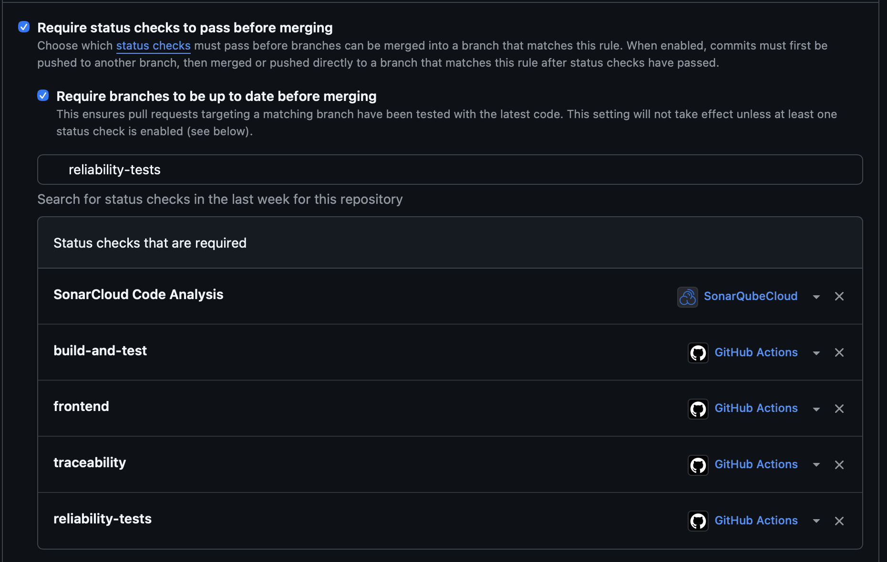

# Звіт про надійність (Lab 9 — Resilience Engineering)

| Параметр                                       | Значення                                                                                                       |
|:-----------------------------------------------|:---------------------------------------------------------------------------------------------------------------|
| **Проєкт**                                     | UniSpace                                                                                                       |
| **Основа**                                     | [`scavenger-hunt.md`](scavenger-hunt.md) (ризики `REL-H01`…`REL-H09`) і код гілки `main` станом на 15.11.2026  |
| **Дослідниця ризиків та аналітикиня відмов**   | Дар'я Спіріна *(пошук, класифікація, повторна перевірка, виправлення та тести `REL-H05`)*                      |
| **Інженерка надійності**                       | Дар'я Мельник *(виправлення `REL-H01`…`H03`, `H08`, `H09`, тести `REL-H08`, реалізація та тести health check)* |
| **Тестувальниця та інженерка надійності**      | Ольга Михайлик *(виправлення `REL-H04`, `H07`, тести надійності, налаштування CI)*                             |
| **Відповідальна за документацію та інженерка** | Анастасія Трекурова *(виправлення й тести `REL-H06`, актуалізація статусів, фінальний звіт)*                   |

> **Примітка:** Статуси звірено з фактичним кодом і тестами репозиторію. Виправлення, для яких немає автоматичного тесту, позначено прямо.

## 1. Підсумок
 
Усі **9 знайдених ризиків надійності повністю виправлено в коді** (`REL-H01`…`REL-H09`).

* **Автоматичні тести** є для всіх серверних виправлень: `REL-H04`, `H05`, `H06`, `H07`, `H08`, `H09` (каталог `Backend/api/tests/reliability/`, а для `REL-H06` — `tests/unit/test_saz_parser.py`).
* **Клієнтські виправлення** (`REL-H01`…`H03` у `api.js`, `layout.js`) не покриті автоматично, оскільки фронтенд-тестів у проєкті немає.
* **Бонуси:** обов'язкова перевірка PR для тестів надійності (`reliability-tests`) та перевірка здоров'я сервісу `GET /api/v1/health/` із реальним запитом до БД та тайм-аутом (див. [розділ 8](#sec-8)).

## 2. Таблиця проблем і критичність
 
|   ID    | Категорія | Ризик                                               | Критичність | Вибір                                              | Статус                            |
|:-------:|:---------:|-----------------------------------------------------|:-----------:|----------------------------------------------------|-----------------------------------|
| REL-H01 |    B/E    | `fetch()` без тайм-ауту                             |  🔴 Висока  | Швидка відмова                                     | ✅ Виправлено (без тесту)          |
| REL-H02 |    A/D    | Некоректний JSON при HTTP 200 стає `null`           | 🟡 Середня  | Швидка відмова                                     | ✅ Виправлено (без тесту)          |
| REL-H03 |    A/C    | CSRF-відповідь не перевіряється                     | 🟡 Середня  | Швидка відмова                                     | ✅ Виправлено (без тесту)          |
| REL-H04 |     C     | `rowspan`/`colspan` без перевірки типу й меж        |  🔴 Висока  | Швидка відмова                                     | ✅ Виправлено, є тести             |
| REL-H05 |     C     | Некоректний час із HTML (`25:99-26:99`)             | 🟡 Середня  | Швидка відмова                                     | ✅ Виправлено, є тести             |
| REL-H06 |    C/E    | Необмежений діапазон тижнів                         |  🔴 Висока  | Безпечна відмова (рядок пропущено з попередженням) | ✅ Виправлено, є тести             |
| REL-H07 |    A/D    | Неочікувана помилка лишає `SyncLog` в `in_progress` |  🔴 Висока  | Швидка відмова                                     | ✅ Виправлено, є тести             |
| REL-H08 |    A/B    | Збої MSAL, крім `ValueError`, → 500                 | 🟡 Середня  | Швидка відмова (контрольована помилка входу)       | ✅ Виправлено, є тести             |
| REL-H09 |    C/E    | `limit` без верхньої межі                           | 🟡 Середня  | Швидка відмова (400)                               | ✅ Виправлено, є тести             |
 
> **Розподіл за критичністю:** 🔴 Висока — **4** *(усі виправлено)*; 🟡 Середня — **5** *(усі виправлено)*.

## 3. До / після (фрагменти коду)

Натисніть на знахідку, щоб переглянути порівняння коду до та після виправлення.

<details>
<summary><b>REL-H01</b> · Тайм-аут запитів — <code>Frontend/static/js/api.js</code>, <code>layout.js</code></summary>

> Той самий тайм-аут (10 с) додано до запиту CSRF-токена в `getCsrfToken()`. У `layout.js` запити перевірки автентифікації мають тайм-аути 5 с і 3 с.

```diff
- const response = await fetch(url, { method, headers, body, credentials: 'include' });
+ const response = await fetch(url, {
+     method, headers, body,
+     credentials: 'include',
+     signal: AbortSignal.timeout(timeout)
+ });
```
</details>

<details>
<summary><b>REL-H02</b> · Некоректний JSON при успішному статусі — <code>Frontend/static/js/api.js</code></summary>

```diff
- const payload = await response.json().catch(() => null);
+ let payload;
+ try {
+     payload = await response.json();
+ } catch (error) {
+     if (response.ok) {
+         throw new Error('Отримано некоректну JSON-відповідь від сервера');
+     }
+     payload = null;
+ }
  if (!response.ok) { throw new ApiError(response.status, payload); }
  return payload;
```
</details>

<details>
<summary><b>REL-H03</b> · Перевірка CSRF-токена — <code>Frontend/static/js/api.js</code></summary>

```diff
  const response = await fetch(`${apiBase}auth/csrf/`, { credentials: 'include', signal: AbortSignal.timeout(10000) });
- csrfToken = (await response.json()).csrfToken;
+ if (!response.ok) {
+     throw new Error(`Не вдалося отримати CSRF-токен (Статус: ${response.status})`);
+ }
+ const data = await response.json();
+ if (!data || typeof data.csrfToken !== 'string' || !data.csrfToken.trim()) {
+     throw new Error('Отримано невалідний CSRF-токен');
+ }
+ csrfToken = data.csrfToken;
```
</details>
 
<details>
<summary><b>REL-H04</b> · Перевірка меж <code>rowspan</code> / <code>colspan</code> — <code>Backend/api/services/saz_parser.py</code></summary>

```diff
+ MAX_ROWSPAN = 200
+ MAX_COLSPAN = 20
+
+ def _span(attrs, name, limit):
+     raw = (attrs.get(name) or "1").strip()
+     if not raw.isdigit() or not 1 <= int(raw) <= limit:
+         raise SazParseError(f"Некоректний атрибут {name}=«{raw[:20]}» у таблиці розкладу (дозволено 1–{limit})")
+     return int(raw)
+
- span = (int(attrs.get("rowspan") or 1), int(attrs.get("colspan") or 1))
+ span = (_span(attrs, "rowspan", MAX_ROWSPAN), _span(attrs, "colspan", MAX_COLSPAN))
```
</details>
 
<details>
<summary><b>REL-H05</b> · Валідація часу заняття — <code>Backend/api/services/saz_parser.py::_parse_time</code></summary>

```diff
  h1, m1, h2, m2 = (int(value) for value in match.groups())
- return time(h1, m1), time(h2, m2)
+ try:
+     start = time(h1, m1)
+     end = time(h2, m2)
+ except ValueError as error:
+     raise SazParseError(f"Некоректний час заняття «{text}»: години мають бути 0–23, хвилини — 0–59") from error
+
+ if end <= start:
+     raise SazParseError(f"Некоректний час заняття «{text}»: час завершення має бути пізніше за час початку")
+ return start, end
```
</details>
 
<details>
<summary><b>REL-H06</b> · Межі номерів тижнів — <code>Backend/api/services/saz_parser.py::parse_weeks</code></summary>

> `parse_schedule` перехоплює цей `ValueError` на рівні рядка й додає попередження `«Рядок N: …»`, тож один рядок із нереальними тижнями не зупиняє імпорт решти розкладу.

```diff
+ MIN_WEEK = 1
+ MAX_WEEK = 30
+
+ def _check_week_bounds(first, last, text):
+     if first < MIN_WEEK or last > MAX_WEEK:
+         raise ValueError(f"Номер тижня поза межами {MIN_WEEK}-{MAX_WEEK}: {text}")
+
+ _check_week_bounds(first, last, text)
  weeks.update(range(first, last + 1))
```
</details>

<details>
<summary><b>REL-H07</b> · Закриття журналу синхронізації — <code>Backend/api/services/saz_import.py</code></summary>

```diff
  except (SazParseError, ValueError) as error:
      log.status = SyncLog.SyncStatus.FAILED
      log.error_message = str(error)
      result = None
+ except Exception as error:
+     logger.exception("Неочікувана помилка імпорту САЗ (SyncLog %s)", log.pk)
+     _mark_failed(log, f"Неочікувана помилка імпорту: {type(error).__name__}")
+     raise
  else:
      log.status = SyncLog.SyncStatus.SUCCESS
```
</details>
 
<details>
<summary><b>REL-H08</b> · Збої та тайм-аут під час входу через Microsoft — <code>Backend/api/services/microsoft_auth.py</code>, <code>auth_views.py</code></summary>

```diff
  def build_msal_app():
      return msal.ConfidentialClientApplication(
          settings.MS_CLIENT_ID,
          authority=f"[https://login.microsoftonline.com/](https://login.microsoftonline.com/){settings.MS_TENANT_ID}",
          client_credential=settings.MS_CLIENT_SECRET,
+         timeout=MSAL_HTTP_TIMEOUT_SECONDS,
      )

  def start_login():
-     return build_msal_app().initiate_auth_code_flow(LOGIN_SCOPES, redirect_uri=settings.MS_REDIRECT_URI)
+     try:
+         flow = build_msal_app().initiate_auth_code_flow(LOGIN_SCOPES, redirect_uri=settings.MS_REDIRECT_URI)
+     except (requests.exceptions.RequestException, ValueError) as error:
+         logger.error("Помилка звернення до Microsoft під час ініціалізації входу: %s", error)
+         raise MicrosoftLoginError(MS_UNAVAILABLE_MESSAGE) from error
+
+     if "error" in flow or "auth_uri" not in flow:
+         logger.error("Microsoft повернув помилку ініціалізації входу: %s (%s)", flow.get("error"), flow.get("error_description"))
+         raise MicrosoftLoginError(MS_UNAVAILABLE_MESSAGE)
+     return flow

  def finish_login(flow, query_params):
      try:
          result = build_msal_app().acquire_token_by_auth_code_flow(flow, query_params)
      except ValueError as error:
          raise MicrosoftLoginError("Невалідна відповідь Microsoft") from error
+     except requests.exceptions.RequestException as error:
+         logger.error("Помилка мережі під час звернення до Microsoft: %s", error)
+         raise MicrosoftLoginError(MS_UNAVAILABLE_MESSAGE) from error

      if "error" in result:
-         raise MicrosoftLoginError(result.get("error_description") or result["error"])
+         logger.warning("Відмова авторизації Microsoft: error=%s, description=%s", result.get("error"), result.get("error_description"))
+         raise MicrosoftLoginError(MS_AUTH_REJECTED_MESSAGE)
```
</details>
 
<details>
<summary><b>REL-H09</b> · Верхня межа пагінації <code>limit</code> — <code>Backend/api/serializers.py</code></summary>

```diff
- limit = serializers.IntegerField(min_value=1, default=20, help_text="Кількість записів")
+ limit = serializers.IntegerField(min_value=1, max_value=200, default=20, help_text="Кількість записів")
```

</details>
 
## 4. Застосовані патерни надійності
 
| Патерн                                              | Де застосовано                                                                                                                                                                                                                                                 |
|-----------------------------------------------------|----------------------------------------------------------------------------------------------------------------------------------------------------------------------------------------------------------------------------------------------------------------|
| Тайм-аути на зовнішні операції                      | REL-H01: `AbortSignal.timeout(...)` для запитів до API, CSRF і перевірки автентифікації; REL-H08: `timeout = 10` с у `ConfidentialClientApplication` (MSAL); Бонус (`GET /api/v1/health/`): `statement_timeout = 2000` мс для запиту до БД                     |
| Захисні перевірки (guard clauses) і перевірка входу | REL-H03 (формат токена), REL-H04 (`_span`, межі 1…200 і 1…20), REL-H05 (години 0–23, хвилини 0–59, початок < кінець), REL-H06 (`_check_week_bounds`, тижні 1…30), REL-H08 (перевірка `auth_uri` у `flow`), REL-H09 (`max_value=200`)                           |
| Чіткі та вузькі обробники помилок                   | REL-H02 (різна реакція для успішного й помилкового статусу), REL-H05 (`ValueError` → `SazParseError`), REL-H07 (очікувані помилки окремо від неочікуваних; у `_mark_failed` ловиться лише `DatabaseError`), REL-H08 (`RequestException` і `ValueError` у MSAL) |
| Логування проблеми                                  | REL-H07 (`logger.exception`), REL-H08 (`logger.error` для мережевих збоїв MSAL та `logger.warning` для `error_description` відмови OAuth)                                                                                                                      |
| Безпечне повідомлення користувачу                   | REL-H07 (лише тип помилки, без SQL і шляхів), REL-H04 і REL-H05 (зрозумілий `SazParseError` замість сирого винятку Python), REL-H08 (приховано службовий `error_description` із `Trace ID` / `AADSTS`-кодами Microsoft)                                        |
| Контрольована деградація                            | REL-H06: рядок із нереальними тижнями пропускається з попередженням, решта розкладу імпортується; при невдалому імпорті лишається попередній успішний розклад                                                                                                  |
| Закриття стану при збої                             | REL-H07: журнал не лишається в `in_progress`                                                                                                                                                                                                                   |
| Перевірка здоров'я залежності                       | Бонус: `GET /api/v1/health/` ([розділ 8](#sec-8))                                                                                                                                                                                                              |
 
**Повтори (retries) з відступом і джитером у проєкті не реалізовано** і тут не заявляються. Виклик Microsoft — це обмін одноразового коду авторизації (повтор не ідемпотентний), а імпорт САЗ запускає людина, яка може повторити дію сама.

## 5. Режими відмов і відновлення
 
|   ID    |          Тип відмови          | Що бачить користувач під час збою                                                                                                                                                                                                                           | Як система повертається до норми                                                                                                                                                                                                                               |
|:-------:|:-----------------------------:|-------------------------------------------------------------------------------------------------------------------------------------------------------------------------------------------------------------------------------------------------------------|----------------------------------------------------------------------------------------------------------------------------------------------------------------------------------------------------------------------------------------------------------------|
| REL-H01 |          **Швидка**           | Запит перервано через 10 с (5 с або 3 с для перевірки автентифікації); інтерфейс показує помилку замість нескінченного очікування (див. зауваження нижче)                                                                                                   | Користувач повторює дію; автоматичних повторів немає (для запису вони могли б продублювати дію)                                                                                                                                                                |
| REL-H02 |          **Швидка**           | «Отримано некоректну JSON-відповідь від сервера» замість порожнього екрана                                                                                                                                                                                  | Користувач повторює дію або оновлює сторінку; причину має дослідити команда                                                                                                                                                                                    |
| REL-H03 |          **Швидка**           | «Не вдалося отримати CSRF-токен (Статус: N)» або «Отримано невалідний CSRF-токен»; запис не надсилається                                                                                                                                                    | Токен не кешується, тож наступна спроба запитує його заново                                                                                                                                                                                                    |
| REL-H04 |          **Швидка**           | Диспетчер бачить спробу в журналі зі статусом `failed` і повідомленням на зразок «Некоректний атрибут colspan=«1000000» у таблиці розкладу (дозволено 1–20)»                                                                                                | Раніше імпортовані дані не змінюються (REL-002). Диспетчер завантажує коректну сторінку САЗ. Значення за замовчуванням свідомо не підставлено: некоректний `rowspan` зсунув би дні й час у наступних рядках                                                    |
| REL-H05 |          **Швидка**           | Журнал `failed` із повідомленням «Некоректний час заняття «25:99-26:99»: години мають бути 0–23, хвилини — 0–59»                                                                                                                                            | Раніше імпортовані заняття й бронювання лишаються без змін; диспетчер виправляє файл і повторює імпорт. Автоматична підміна часу могла б створити хибний розклад і бронювання. Нерозпізнаний формат часу («час уточнюється») лишається попередженням про рядок |
| REL-H06 | **Безпечна** (на рівні рядка) | Імпорт завершується, у попередженнях: «Рядок N: Номер тижня поза межами 1-30: …»; решта розкладу імпортована                                                                                                                                                | Диспетчер виправляє дані в САЗ і імпортує повторно. Сервер не виконує мільйони ітерацій                                                                                                                                                                        |
| REL-H07 |          **Швидка**           | У журналі запис `failed` із текстом «Неочікувана помилка імпорту: <тип помилки>»; сам запит завершується помилкою сервера                                                                                                                                   | Журнал не висить в `in_progress`; деталі (SQL, traceback) лише в лозі сервера. Після усунення причини диспетчер повторює імпорт. Якщо недоступна й база, помилка логується, а початковий виняток не підміняється                                               |
| REL-H08 |          **Швидка**           | При збої мережі — контрольована відповідь (`503` на старті входу, `400` на callback) «Сервіс авторизації Microsoft тимчасово недоступний. Спробуйте пізніше.»; при помилці OAuth — безпечний текст без службового `error_description`; сесія не створюється | Користувач повторює вхід пізніше. Існуючі сесії працюють; технічні коди Microsoft збережено лише в лозі сервера                                                                                                                                                |
| REL-H09 |          **Швидка**           | `400 VALIDATION_ERROR` із полем `limit`                                                                                                                                                                                                                     | Клієнт надсилає `limit` у межах 1–200 і отримує відповідь                                                                                                                                                                                                      |
 
* **Чому швидка, а не безпечна відмова:** Для імпорту розкладу неправильна відповідь (хибні заняття й бронювання) гірша за відсутню, а для CSRF, формату API і входу мовчазне значення за замовчуванням приховувало б реальну причину збою або обходило б автентифікацію.


* **Чому для REL-H06 обрано безпечну відмову:** Нереальні тижні в одному рядку не зсувають решту таблиці (на відміну від `rowspan` у `REL-H04` чи часу в `REL-H05`), тому пропустити лише цей рядок і явно повідомити про нього безпечніше, ніж скасовувати весь імпорт.


* **Зауваження до REL-H01:** Тайм-аут через `AbortSignal.timeout` завершується винятком `TimeoutError` браузера, а сторінки показують `UniSpaceApi.describeError(error)`, тобто його стандартне повідомлення, а не окремий український текст. Також тайм-аут браузера не доводить, що сервер не виконав запис, тому перед повторною дією варто перевірити результат попередньої операції. Окремий текст про тайм-аут і значення тайм-ауту за вимірами затримок не обґрунтовано; перевірка в браузері не виконувалась.

## 6. Тести надійності

Відповідальні: Ольга Михайлик, Дар'я Спіріна, Дар'я Мельник. 

Тести лежать у `Backend/api/tests/reliability/`, працюють зі справжньою PostgreSQL (як і решта набору) і позначені вимогами `REL-001` / `REL-002`, тож їх бачить CI-перевірка простежуваності.

Запуск: `cd Backend && python -m pytest api/tests/reliability -v`

| Тип тесту                                                  | Файл / тест                                          | Сценарій                                                                                                                                                                                                 | Обрана реакція, яку перевіряє тест                                                                                                                                                                                                                                                            |    Проблема     |
|------------------------------------------------------------|------------------------------------------------------|----------------------------------------------------------------------------------------------------------------------------------------------------------------------------------------------------------|-----------------------------------------------------------------------------------------------------------------------------------------------------------------------------------------------------------------------------------------------------------------------------------------------|:---------------:|
| Обробка помилки                                            | `test_error_handling.py` (`1` тест)                  | Після успішного імпорту диспетчер завантажує через `POST /api/v1/sync/` сторінку САЗ із `colspan="1000000"`                                                                                              | Система не падає: `201`, статус `failed`, `summary = null`, зрозуміле повідомлення «Некоректний атрибут colspan…» без сирого тексту винятку Python; запис `failed` у `SyncLog`; раніше імпортовані заняття не змінено                                                                         |     REL-H04     |
| Зовнішня відмова (ін'єкція збою)                           | `test_external_failure.py` (`1` тест)                | Тестовий дублер (`unittest.mock.patch`) підміняє `import_schedule` і кидає `OperationalError` — обрив з'єднання з PostgreSQL посеред імпорту                                                             | Швидка відмова: клієнт отримує `500` без внутрішніх деталей (адреса сервера БД у відповідь не потрапляє); `SyncLog` закрито як `failed` із `finished_at` і загальним повідомленням «Неочікувана помилка імпорту: OperationalError»; деталі збою — у лозі сервера; жодного заняття не створено |     REL-H07     |
| Граничний                                                  | `test_boundaries.py` (`8` випадків)                  | `rowspan`/`colspan` рівно на межах і на крок за ними: `1`, `MAX_ROWSPAN = 200`, `MAX_COLSPAN = 20` проти `0`, `201`, `21`                                                                                | Значення на межі приймаються, на крок за межею — `SazParseError` «Некоректний атрибут …» (без помилки на одиницю в жодний бік)                                                                                                                                                                |     REL-H04     |
| Валідація входу та граничні значення часу                  | `test_saz_time.py` (`5` тестів)                      | Парсинг та імпорт розкладу з некоректними годинами/хвилинами (`25:99`), зворотним інтервалом часу (`10:00-09:00`), граничними значеннями (`00:00-23:59`) та нерозпізнаним текстовим форматом             | Швидка відмова (`SazParseError`) для невалідного числового часу без зміни вже збережених занять у БД; збереження попередньої поведінки (пропуск із попередженням) для нерозпізнаного формату                                                                                                  |     REL-H05     |
| Граничний (пагінація)                                      | `test_pagination_limits.py` (`6` випадків)           | Клієнт запитує список аудиторій або бронювань з `limit` на межі (`1`, `200`) і за нею (`201`, `100000`)                                                                                                  | На межі — `200 OK`; за межею — швидка відмова `400 VALIDATION_ERROR` з полем `limit` ще до запиту в БД, без виснаження пам'яті                                                                                                                                                                |     REL-H09     |
| Зовнішня відмова та безпека помилок OAuth (ін'єкція збою)  | `test_microsoft_auth_reliability.py` (`7` випадків)  | Перевірка `timeout=10` у клієнті MSAL; ін'єкція `Timeout`, `ConnectionError` та `ValueError` у `microsoft-login` і `microsoft-callback`; відповідь Microsoft із сирим `error_description` (`Trace ID`)   | Швидка контрольована відмова (`503` на старті входу, `400` на callback) без створення сесії та без витоку `AADSTS`/`Trace ID` у відповідь користувачу; деталі пишуться лише в серверний лог                                                                                                   |     REL-H08     |
| Перевірка здоров'я залежності (ін'єкція збою)              | `test_health.py` (`2` тести)                         | Запит `GET /api/v1/health/` при працюючій PostgreSQL та при ін'єкції `OperationalError` під час відкриття курсора й виконання `SELECT 1`                                                                 | При живій БД — `200 OK` (`{"status": "healthy"}`); при збої БД — контрольована швидка відмова `503 Service Unavailable` (`{"status": "unhealthy", "dependency": "database"}`) замість необробленого `500`                                                                                     | Бонус (REL-001) |

**Що доводять тести разом:**

* користувач (диспетчер або студент) бачить зрозумілий результат і у випадку поганих даних (`failed` з поясненням), і у випадку збою зовнішньої інфраструктури — БД або Microsoft OAuth (`500`, `503` або `400` без витоку технічних деталей);
* система повертається до норми без ручного прибирання стану: журнал синхронізації не «зависає» в `in_progress`, а невдалий вхід через Microsoft не залишає напіввідкритої сесії;
* раніше імпортовані дані за жодного зі збоїв не змінюються (REL-002);
* завеликий параметр пагінації (`limit`) відхиляється до звернення до бази, тож один запит не може виснажити пам'ять чи перевантажити PostgreSQL (REL-H09);
* моніторинг через `/api/v1/health/` перевіряє реальне виконання запиту до БД з обмеженням часу і коректно сигналізує про деградацію залежності статусом `503` (REL-001).

**Результат прогону тестів цього розділу:**

`python -m pytest api/tests/reliability -v` — 30 passed (1 + 1 + 8 + 5 + 6 + 7 + 2).

## 7. Відкриті проблеми
 
Усі 9 знахідок із `scavenger-hunt.md` (`REL-H01`…`REL-H09`) повністю усунено в коді, а всі серверні виправлення (`REL-H04`…`REL-H09`) покрито автоматичними тестами. Відкритим залишається лише автоматизоване тестування клієнтських виправлень `REL-H01`…`REL-H03` у браузері (у проєкті немає інфраструктури фронтенд-тестів).
 
Поза межами аналізу `scavenger-hunt.md` у коді також помічено (потенційні ризики для окремої перевірки): `EMAIL_PORT = int(...)` без валідації (`settings.py`), захардкоджений `"request_id": "req_abc123"` у відповідях помилок (`views.py`), розсилка листів у HTTP-запиті з обробкою лише `OSError` (`notifications.py`).

## <a id="sec-8"></a>8. Бонуси

### Тести надійності як обов'язкова перевірка PR

**Що зроблено.** У `.github/workflows/ci.yml` додано окремий job `reliability-tests`, який на кожен PR і push у `main` запускає лише тести з `Backend/api/tests/reliability/` (`python -m pytest api/tests/reliability -v`) на власному сервісі PostgreSQL 16 і зберігає результати як артефакт `reliability-results`. Окремий job потрібен, бо правило захисту гілки (branch protection) робить обов'язковою саме перевірку-job, а не крок усередині іншого job. Цей job додано до обов'язкових перевірок гілки `main` (Settings → Branches → Branch protection rule для `main` → Require status checks to pass → `reliability-tests`), тож PR із червоними тестами надійності влити не можна.

**Як працює:**

* job стартує паралельно з `build-and-test`; PostgreSQL прив'язано до порту хоста `5433`, щоб не конфліктувати з базою `build-and-test` на тому самому self-hosted runner;
* якщо будь-який із тестів обробки помилки, ін'єкції збою чи граничних значень падає, job стає червоним, і кнопку злиття PR заблоковано.

**Докази:**

| Артефакт / Перевірка             | Посилання                                                                                                                                          |
|----------------------------------|----------------------------------------------------------------------------------------------------------------------------------------------------|
| **Успішний прогін у CI**         | [CI Pipeline, job `reliability-tests` (run 43081958822)](https://github.com/ukma-fin-ssdm-2026/unispace/actions/runs/43081958822/job/130736510854) |
| **Правило захисту гілки `main`** | Скриншот нижче: `reliability-tests` у списку «Status checks that are required» разом із `build-and-test`, `frontend`, `traceability` і SonarCloud  |



**Відповідальна:** Ольга Михайлик.

---

### Перевірка здоров'я сервісу (Health Check)

**Що зроблено.** Реалізовано ендпоінт `GET /api/v1/health/` (`HealthCheckAPIView` у `Backend/api/views.py`, маршрут `health-check` у `Backend/api/urls.py`, впроваджено в [PR #340](https://github.com/ukma-fin-ssdm-2026/unispace/pull/340) і вдосконалено реальним запитом із тайм-аутом у [PR #360](https://github.com/ukma-fin-ssdm-2026/unispace/pull/360)), який перевіряє реальну доступність і час відгуку критичної залежності системи — бази даних PostgreSQL.

**Як працює:**

* замість поверхневого `connection.ensure_connection()` (який на вже відкритому з'єднанні не звертається до бази даних), сервіс відкриває курсор у межах `transaction.atomic()` і виконує параметризований запит `SELECT set_config('statement_timeout', %s, true), 1;` зі значенням тайм-ауту `2000` мс (`HEALTH_CHECK_DB_TIMEOUT_MS = "2000"`);
* третій аргумент `true` у `set_config` обмежує дію `statement_timeout` лише поточною транзакцією (аналог `SET LOCAL`), тому це налаштування не впливає на інші запити з пулу з'єднань, а передача параметра через плейсхолдер `%s` унеможливлює SQL-ін'єкції;
* якщо база даних успішно виконує запит у межах 2 секунд, ендпоінт повертає `200 OK` із тілом `{"status": "healthy"}`;
* якщо база даних недоступна або перевищено час очікування (`DatabaseError` / `OperationalError`), виняток перехоплюється, і сервіс повертає контрольовану швидку відмову `503 Service Unavailable` із тілом `{"status": "unhealthy", "dependency": "database"}` без витоку внутрішніх деталей підключення.

<details>
<summary><b>Показати код реалізації (Backend/api/views.py)</b></summary>

```python
HEALTH_CHECK_DB_TIMEOUT_MS = "2000"


class HealthCheckResponseSerializer(serializers.Serializer):
    status = serializers.CharField()
    dependency = serializers.CharField(required=False)


class HealthCheckAPIView(APIView):
    permission_classes = [AllowAny]

    @extend_schema(
        summary="Перевірка здоров'я сервісу",
        responses={200: HealthCheckResponseSerializer, 503: HealthCheckResponseSerializer},
    )
    def get(self, request, format=None):
        try:
            with transaction.atomic(), connection.cursor() as cursor:
                cursor.execute("SELECT set_config('statement_timeout', %s, true), 1;", [HEALTH_CHECK_DB_TIMEOUT_MS])
                cursor.fetchone()
            return Response({"status": "healthy"}, status=status.HTTP_200_OK)
        except DatabaseError:
            return Response(
                {"status": "unhealthy", "dependency": "database"},
                status=status.HTTP_503_SERVICE_UNAVAILABLE,
            )
```
</details>

**Перевірка тестами (`Backend/api/tests/reliability/test_health.py`):**

* `test_health_check_returns_healthy_when_db_is_up` — перевіряє відповідь `200 OK` (`{"status": "healthy"}`) при працюючій PostgreSQL;
* `test_health_check_returns_unhealthy_on_db_failure` — за допомогою ін'єкції збою `unittest.mock.patch("django.db.connection.cursor", side_effect=OperationalError("DB down"))` імітує відмову БД і перевіряє повернення статусу `503 Service Unavailable` із тілом `{"status": "unhealthy", "dependency": "database"}`.

<details>
<summary><b>Показати код тестів (Backend/api/tests/reliability/test_health.py)</b></summary>

```python
@pytest.mark.req("REL-001")
def test_health_check_returns_healthy_when_db_is_up(api_client):
    response = api_client.get(reverse("health-check"))

    assert response.status_code == status.HTTP_200_OK
    assert response.json() == {"status": "healthy"}


@pytest.mark.req("REL-001")
def test_health_check_returns_unhealthy_on_db_failure(api_client):
    with patch("django.db.connection.cursor", side_effect=OperationalError("DB down")):
        response = api_client.get(reverse("health-check"))

    assert response.status_code == status.HTTP_503_SERVICE_UNAVAILABLE
    assert response.json() == {"status": "unhealthy", "dependency": "database"}
```
</details>

**Докази:**

| Артефакт / Перевірка                                         | Посилання та опис                                                                                                                                                                                                  |
|:-------------------------------------------------------------|:-------------------------------------------------------------------------------------------------------------------------------------------------------------------------------------------------------------------|
| **Початкова реалізація та демонстрація у відео**             | [PR #340](https://github.com/ukma-fin-ssdm-2026/unispace/pull/340) *(також продемонстровано у відеозаписі захисту Лаб 9)*                                                                                          |
| **Заміна `ensure_connection()` на `SELECT 1` із тайм-аутом** | [PR #360 (коміт `5c64c50`)](https://github.com/ukma-fin-ssdm-2026/unispace/pull/360) — параметризований запит із `statement_timeout = 2000` мс та оновлені тести (усі перевірки CI пройдено)                       |
| **Код ендпоінта `HealthCheckAPIView`**                       | [`Backend/api/views.py`](https://github.com/ukma-fin-ssdm-2026/unispace/blob/main/Backend/api/views.py)                                                                                                            |
| **Автоматичні тести (`200 OK` та `503` при збої)**           | [`Backend/api/tests/reliability/test_health.py`](https://github.com/ukma-fin-ssdm-2026/unispace/blob/main/Backend/api/tests/reliability/test_health.py) *(виконуються в обов'язковому CI job `reliability-tests`)* |

**Відповідальна:** Дар'я Мельник.

---
> **Примітка щодо використання ШІ:** Первинну чернетку звіту та основу тестів надійності підготовлено за допомогою ШІ (Claude, Gemini) на основі [`scavenger-hunt.md`](scavenger-hunt.md), коду, тестів і CI-конфігурації репозиторію; також за допомогою ШІ (Gemini) підготовлено опис реалізації та тестування ендпоінта перевірки здоров'я сервісу (`GET /api/v1/health/`). Структурування таблиць, інтерактивні блоки (`<details>`), `diff`-порівняння коду, актуалізацію статусу `REL-H08` та зведення результатів виконала інженерка надійності (Дар'я Мельник). Усі статуси виправлень звірено з фактичним кодом `main`; автоматичні тести мовними моделями не запускались, а наведені результати прогонів отримано локально та в CI. Фінальний текст і тести перевірили та підтвердили відповідальна за документацію (Анастасія Трекурова), тестувальниця (Ольга Михайлик), дослідниця ризиків (Дар'я Спіріна) та інженерка надійності (Дар'я Мельник).
