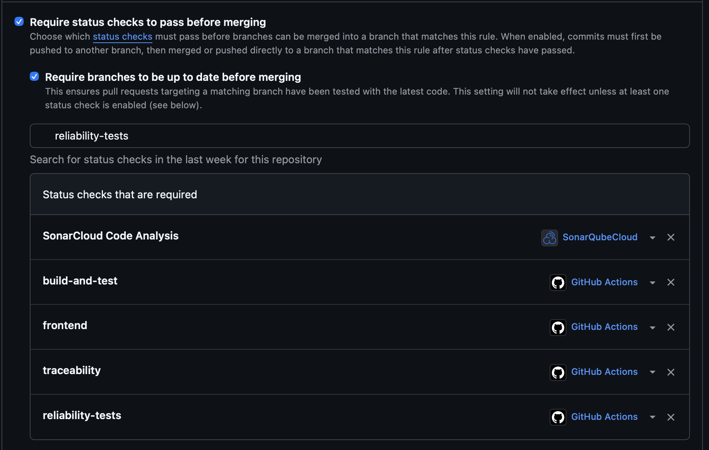

**Проєкт:** UniSpace  
**Основа:** [`scavenger-hunt.md`](scavenger-hunt.md) (ризики REL-H01…REL-H09) і код гілки `main` станом на 12.11.2026.  
**Команда (ролі Lab09):** дослідниця ризиків — Дар'я Спіріна; аналітикиня відмов — Ксенія Тимохина; інженерка надійності — Дар'я Мельник; відповідальна за документацію — Анастасія Трекурова; тестувальниця надійності — Ольга Михайлик.
 
> Статуси звірено з фактичним кодом і тестами репозиторію. Виправлення, для яких немає автоматичного тесту, та ризики, виправлені лише частково, позначено прямо.
 
## 1. Підсумок
 
З 9 знайдених ризиків надійності **8 виправлено в коді** (REL-H01, H02, H03, H04, H05, H06, H07, H09), **1 виправлено частково** (REL-H08).
 
* Автоматичні тести є для REL-H04, H05, H06, H07, H09 (каталог `Backend/api/tests/reliability/`, а для REL-H06 — `tests/unit/test_saz_parser.py`).
* REL-H01…H03 живуть у клієнті (`api.js`, `layout.js`), фронтенд-тестів у проєкті немає, тож вони не покриті автоматично.
* REL-H08 виправлено лише для обміну коду на токен; решту зазначено в розділі 7.
* Бонуси: обов'язкова перевірка PR для тестів надійності та перевірка здоров'я сервісу (розділ 8).
  
## 2. Таблиця проблем і критичність
 
| ID | Категорія | Ризик | Критичність | Вибір | Статус |
|---|---|---|---|---|---|
| REL-H01 | B/E | `fetch()` без тайм-ауту | Висока | Швидка відмова | ✅ Виправлено (без тесту) |
| REL-H02 | A/D | Некоректний JSON при HTTP 200 стає `null` | Середня | Швидка відмова | ✅ Виправлено (без тесту) |
| REL-H03 | A/C | CSRF-відповідь не перевіряється | Середня | Швидка відмова | ✅ Виправлено (без тесту) |
| REL-H04 | C | `rowspan`/`colspan` без перевірки типу й меж | Висока | Швидка відмова | ✅ Виправлено, є тести |
| REL-H05 | C | Некоректний час із HTML (`25:99-26:99`) | Середня | Швидка відмова | ✅ Виправлено, є тести |
| REL-H06 | C/E | Необмежений діапазон тижнів | Висока | Безпечна відмова (рядок пропущено з попередженням) | ✅ Виправлено, є тести |
| REL-H07 | A/D | Неочікувана помилка лишає `SyncLog` в `in_progress` | Висока | Швидка відмова | ✅ Виправлено, є тести |
| REL-H08 | A/B | Збої MSAL, крім `ValueError`, → 500 | Середня | Швидка відмова (контрольована помилка входу) | 🟡 Виправлено частково, без тесту |
| REL-H09 | C/E | `limit` без верхньої межі | Середня | Швидка відмова (400) | ✅ Виправлено, є тести |
 
Розподіл за критичністю: висока — 4 (усі виправлено), середня — 5 (4 виправлено, 1 частково).
 
## 3. До / після (фрагменти коду)
 
### REL-H01 · тайм-аут запитів (`Frontend/static/js/api.js`, `layout.js`)
 
```javascript
// ДО
const response = await fetch(url, { method, headers, body, credentials: 'include' });
```
 
```javascript
// ПІСЛЯ: тайм-аут 10 с за замовчуванням, його можна змінити параметром timeout
const response = await fetch(url, {
    method, headers, body,
    credentials: 'include',
    signal: AbortSignal.timeout(timeout)
});
```
 
Той самий тайм-аут (10 с) додано до запиту CSRF-токена в `getCsrfToken()`. У `layout.js` запити перевірки автентифікації мають тайм-аути 5 с і 3 с.
 
### REL-H02 · некоректний JSON при успішному статусі
 
```javascript
// ДО
const payload = await response.json().catch(() => null);
if (!response.ok) { throw new ApiError(response.status, payload); }
return payload;
```
 
```javascript
// ПІСЛЯ
let payload;
try {
    payload = await response.json();
} catch (error) {
    if (response.ok) {
        throw new Error('Отримано некоректну JSON-відповідь від сервера');
    }
    payload = null;
}
if (!response.ok) { throw new ApiError(response.status, payload); }
return payload;
```
 
### REL-H03 · перевірка CSRF-токена
 
```javascript
// ДО
const response = await fetch(`${apiBase}auth/csrf/`, { credentials: 'include' });
csrfToken = (await response.json()).csrfToken;
```
 
```javascript
// ПІСЛЯ
if (!response.ok) {
    throw new Error(`Не вдалося отримати CSRF-токен (Статус: ${response.status})`);
}
const data = await response.json();
if (!data || typeof data.csrfToken !== 'string' || !data.csrfToken.trim()) {
    throw new Error('Отримано невалідний CSRF-токен');
}
csrfToken = data.csrfToken;
```
 
### REL-H04 · `rowspan`/`colspan` (`Backend/api/services/saz_parser.py`)
 
```python
# ДО
span = (int(attrs.get("rowspan") or 1), int(attrs.get("colspan") or 1))
```
 
```python
# ПІСЛЯ
MAX_ROWSPAN = 200
MAX_COLSPAN = 20
 
def _span(attrs, name, limit):
    raw = (attrs.get(name) or "1").strip()
    if not raw.isdigit() or not 1 <= int(raw) <= limit:
        raise SazParseError(f"Некоректний атрибут {name}=«{raw[:20]}» у таблиці розкладу (дозволено 1–{limit})")
    return int(raw)
 
span = (_span(attrs, "rowspan", MAX_ROWSPAN), _span(attrs, "colspan", MAX_COLSPAN))
```
 
### REL-H05 · некоректний час (`saz_parser.py::_parse_time`)
 
```python
# ДО
h1, m1, h2, m2 = (int(value) for value in match.groups())
return time(h1, m1), time(h2, m2)          # time(25, 99) → сирий ValueError
```
 
```python
# ПІСЛЯ
h1, m1, h2, m2 = (int(value) for value in match.groups())
try:
    start = time(h1, m1)
    end = time(h2, m2)
except ValueError as error:
    raise SazParseError(f"Некоректний час заняття «{text}»: години мають бути 0–23, хвилини — 0–59") from error
 
if end <= start:
    raise SazParseError(f"Некоректний час заняття «{text}»: час завершення має бути пізніше за час початку")
return start, end
```
 
### REL-H06 · межі номерів тижнів (`saz_parser.py::parse_weeks`)
 
```python
# ДО: перевірявся лише порядок first <= last
weeks.update(range(first, last + 1))
```
 
```python
# ПІСЛЯ: перевірка меж до побудови range(), тож величезний діапазон не створюється взагалі
MIN_WEEK = 1
MAX_WEEK = 30
 
_check_week_bounds(first, last, text)
weeks.update(range(first, last + 1))
 
def _check_week_bounds(first, last, text):
    if first < MIN_WEEK or last > MAX_WEEK:
        raise ValueError(f"Номер тижня поза межами {MIN_WEEK}-{MAX_WEEK}: {text}")
```
 
`parse_schedule` перехоплює цей `ValueError` на рівні рядка й додає попередження `«Рядок N: …»`, тож один рядок із нереальними тижнями не зупиняє імпорт решти розкладу.
 
### REL-H07 · закриття журналу синхронізації (`Backend/api/services/saz_import.py`)
 
```python
# ДО: будь-який виняток, окрім SazParseError/ValueError, лишав SyncLog в in_progress
try:
    result = import_schedule(parse_schedule(html), semester_start)
except (SazParseError, ValueError) as error:
    log.status = SyncLog.SyncStatus.FAILED
    log.error_message = str(error)
    result = None
else:
    log.status = SyncLog.SyncStatus.SUCCESS
```
 
```python
# ПІСЛЯ
except (SazParseError, ValueError) as error:       # очікувана помилка даних: повідомлення диспетчеру
    log.status = SyncLog.SyncStatus.FAILED
    log.error_message = str(error)
    result = None
except Exception as error:                         # неочікуваний збій
    logger.exception("Неочікувана помилка імпорту САЗ (SyncLog %s)", log.pk)
    _mark_failed(log, f"Неочікувана помилка імпорту: {type(error).__name__}")
    raise
else:
    log.status = SyncLog.SyncStatus.SUCCESS
 
def _mark_failed(log, message):
    """Переводить журнал у failed; якщо недоступна й сама база, лише логує."""
    ...
    try:
        type(log).objects.filter(pk=log.pk).update(**fields)
    except DatabaseError:
        logger.exception("Не вдалося позначити SyncLog %s як failed", log.pk)
```
 
### REL-H08 · збій мережі під час входу через Microsoft (`services/microsoft_auth.py`), виправлено частково
 
```python
# ДО
except ValueError as error:
    raise MicrosoftLoginError("Невалідна відповідь Microsoft") from error
```
 
```python
# ПІСЛЯ
except ValueError as error:
    raise MicrosoftLoginError("Невалідна відповідь Microsoft") from error
except requests.exceptions.RequestException as error:
    logger.error("Помилка мережі під час звернення до Microsoft: %s", error)
    raise MicrosoftLoginError("Сервіс авторизації Microsoft тимчасово недоступний. Спробуйте пізніше.") from error
```
 
Що ще не зроблено, див. розділ 7.
 
### REL-H09 · верхня межа `limit` (`Backend/api/serializers.py`)
 
```python
# ДО
limit = serializers.IntegerField(min_value=1, default=20, help_text="Кількість записів")
```
 
```python
# ПІСЛЯ: у RoomQuerySerializer і UserBookingsQuerySerializer
limit = serializers.IntegerField(min_value=1, max_value=200, default=20, help_text="Кількість записів")
```
 
## 4. Застосовані патерни надійності
 
| Патерн | Де застосовано |
|---|---|
| Тайм-аути на зовнішні операції | REL-H01: `AbortSignal.timeout(...)` для запитів до API, CSRF і перевірки автентифікації |
| Захисні перевірки (guard clauses) і перевірка входу | REL-H03 (формат токена), REL-H04 (`_span`, межі 1…200 і 1…20), REL-H05 (години 0–23, хвилини 0–59, початок < кінець), REL-H06 (`_check_week_bounds`, тижні 1…30), REL-H09 (`max_value=200`) |
| Чіткі та вузькі обробники помилок | REL-H02 (різна реакція для успішного й помилкового статусу), REL-H05 (`ValueError` → `SazParseError`), REL-H07 (очікувані помилки окремо від неочікуваних; у `_mark_failed` ловиться лише `DatabaseError`), REL-H08 (`requests.exceptions.RequestException`) |
| Логування проблеми | REL-H07 (`logger.exception`), REL-H08 (`logger.error` з деталями мережевої помилки) |
| Безпечне повідомлення користувачу | REL-H07 (лише тип помилки, без SQL і шляхів), REL-H04 і REL-H05 (зрозумілий `SazParseError` замість `invalid literal for int()` чи `hour must be in 0..23`), REL-H08 |
| Контрольована деградація | REL-H06: рядок із нереальними тижнями пропускається з попередженням, решта розкладу імпортується; при невдалому імпорті лишається попередній успішний розклад |
| Закриття стану при збої | REL-H07: журнал не лишається в `in_progress` |
| Перевірка здоров'я залежності | Бонус: `GET /api/v1/health/` (розділ 8) |
 
**Повтори (retries) з відступом і джитером у проєкті не реалізовано** і тут не заявляються. Виклик Microsoft — це обмін одноразового коду авторизації (повтор не ідемпотентний), а імпорт САЗ запускає людина, яка може повторити дію сама.
 
## 5. Режими відмов і відновлення
 
| ID | Тип відмови | Що бачить користувач під час збою | Як система повертається до норми |
|---|---|---|---|
| REL-H01 | **Швидка** | Запит перервано через 10 с (5 с або 3 с для перевірки автентифікації); інтерфейс показує помилку замість нескінченного очікування (див. зауваження нижче) | Користувач повторює дію; автоматичних повторів немає (для запису вони могли б продублювати дію) |
| REL-H02 | **Швидка** | «Отримано некоректну JSON-відповідь від сервера» замість порожнього екрана | Користувач повторює дію або оновлює сторінку; причину має дослідити команда |
| REL-H03 | **Швидка** | «Не вдалося отримати CSRF-токен (Статус: N)» або «Отримано невалідний CSRF-токен»; запис не надсилається | Токен не кешується, тож наступна спроба запитує його заново |
| REL-H04 | **Швидка** | Диспетчер бачить спробу в журналі зі статусом `failed` і повідомленням на зразок «Некоректний атрибут colspan=«1000000» у таблиці розкладу (дозволено 1–20)» | Раніше імпортовані дані не змінюються (REL-002). Диспетчер завантажує коректну сторінку САЗ. Значення за замовчуванням свідомо не підставлено: некоректний `rowspan` зсунув би дні й час у наступних рядках |
| REL-H05 | **Швидка** | Журнал `failed` із повідомленням «Некоректний час заняття «25:99-26:99»: години мають бути 0–23, хвилини — 0–59» | Раніше імпортовані заняття й бронювання лишаються без змін; диспетчер виправляє файл і повторює імпорт. Автоматична підміна часу могла б створити хибний розклад і бронювання. Нерозпізнаний формат часу («час уточнюється») лишається попередженням про рядок |
| REL-H06 | **Безпечна** (на рівні рядка) | Імпорт завершується, у попередженнях: «Рядок N: Номер тижня поза межами 1-30: …»; решта розкладу імпортована | Диспетчер виправляє дані в САЗ і імпортує повторно. Сервер не виконує мільйони ітерацій |
| REL-H07 | **Швидка** | У журналі запис `failed` із текстом «Неочікувана помилка імпорту: <тип помилки>»; сам запит завершується помилкою сервера | Журнал не висить в `in_progress`; деталі (SQL, traceback) лише в лозі сервера. Після усунення причини диспетчер повторює імпорт. Якщо недоступна й база, помилка логується, а початковий виняток не підміняється |
| REL-H08 | **Швидка** | Помилка входу «Сервіс авторизації Microsoft тимчасово недоступний. Спробуйте пізніше.» замість необробленого 500; сесія не створюється | Користувач повторює вхід пізніше. Існуючі сесії працюють |
| REL-H09 | **Швидка** | `400 VALIDATION_ERROR` із полем `limit` | Клієнт надсилає `limit` у межах 1–200 і отримує відповідь |
 
**Чому швидка, а не безпечна відмова.** Для імпорту розкладу неправильна відповідь (хибні заняття й бронювання) гірша за відсутню, а для CSRF, формату API і входу мовчазне значення за замовчуванням приховувало б реальну причину збою або обходило б автентифікацію.
 
**Чому для REL-H06 обрано безпечну відмову.** Нереальні тижні в одному рядку не зсувають решту таблиці (на відміну від `rowspan`, REL-H04, чи часу, REL-H05), тому пропустити лише цей рядок і явно повідомити про нього безпечніше, ніж скасовувати весь імпорт.
 
**Зауваження до REL-H01.** Тайм-аут через `AbortSignal.timeout` завершується винятком `TimeoutError` браузера, а сторінки показують `UniSpaceApi.describeError(error)`, тобто його стандартне повідомлення, а не окремий український текст. Також тайм-аут браузера не доводить, що сервер не виконав запис, тому перед повторною дією варто перевірити результат попередньої операції. Окремий текст про тайм-аут і значення тайм-ауту за вимірами затримок не обґрунтовано; перевірка в браузері не виконувалась.

## 6. Тести надійності

Відповідальна: Ольга Михайлик (тестувальниця надійності). Тести лежать у `Backend/api/tests/reliability/`, працюють зі справжньою PostgreSQL (як і решта набору) і позначені вимогою `REL-002`, тож їх бачить CI-перевірка простежуваності.

Запуск: `cd Backend && python -m pytest api/tests/reliability -v`

| Тип тесту | Файл / тест | Сценарій | Обрана реакція, яку перевіряє тест | Проблема |
|---|---|---|---|---|
| Обробка помилки | `test_error_handling.py::test_broken_page_returns_clear_failed_result_and_keeps_data` | Після успішного імпорту диспетчер завантажує через `POST /api/v1/sync/` сторінку САЗ із `colspan="1000000"` | Система не падає: `201`, статус `failed`, `summary = null`, зрозуміле повідомлення «Некоректний атрибут colspan…» без сирого тексту винятку Python; запис `failed` у `SyncLog`; раніше імпортовані заняття не змінено | REL-H04 |
| Зовнішня відмова (ін'єкція збою) | `test_external_failure.py::test_database_outage_during_import_fails_fast_and_closes_sync_log` | Тестовий дублер (`unittest.mock.patch`) підміняє `import_schedule` і кидає `OperationalError` — обрив з'єднання з PostgreSQL посеред імпорту | Швидка відмова: клієнт отримує `500` без внутрішніх деталей (адреса сервера БД у відповідь не потрапляє); `SyncLog` закрито як `failed` із `finished_at` і загальним повідомленням «Неочікувана помилка імпорту: OperationalError»; деталі збою — у лозі сервера; жодного заняття не створено | REL-H07 |
| Граничний | `test_boundaries.py::test_values_on_the_boundary_are_accepted`, `test_boundaries.py::test_values_just_outside_the_boundary_are_rejected` (8 випадків) | `rowspan`/`colspan` рівно на межах і на крок за ними: `1`, `MAX_ROWSPAN = 200`, `MAX_COLSPAN = 20` проти `0`, `201`, `21` | Значення на межі приймаються, на крок за межею — `SazParseError` «Некоректний атрибут …» (без помилки на одиницю в жодний бік) | REL-H04 |
| Граничний (пагінація) | `test_pagination_limits.py::test_room_list_accepts_limit_on_the_boundary`, `::test_room_list_rejects_too_large_limit_with_clear_400`, `::test_user_bookings_limit_boundary` (6 випадків) | Клієнт запитує список аудиторій або бронювань з `limit` на межі (`1`, `200`) і за нею (`201`, `100000`) | На межі — `200 OK`; за межею — швидка відмова `400 VALIDATION_ERROR` з полем `limit` ще до запиту в БД, без виснаження пам'яті | REL-H09 |

**Що доводять тести разом:**

* користувач (диспетчер) бачить зрозумілий результат і у випадку поганих даних (`failed` з поясненням), і у випадку збою інфраструктури (`500` без витоку деталей);
* система повертається до норми без ручного прибирання стану: журнал синхронізації не «зависає» в `in_progress`, тож наступну спробу імпорту можна запускати одразу після усунення причини (виправити сторінку або дочекатися відновлення БД);
* раніше імпортовані дані за жодного зі збоїв не змінюються (REL-002).
* завеликий параметр пагінації (`limit`) відхиляється до звернення до бази, тож один запит не може виснажити пам'ять чи перевантажити PostgreSQL (REL-H09).

**Результат прогону тестів цього розділу:** `python -m pytest api/tests/reliability/test_error_handling.py api/tests/reliability/test_external_failure.py api/tests/reliability/test_boundaries.py api/tests/reliability/test_pagination_limits.py -v` — 16 passed (1 + 1 + 8 + 6).

> Примітка щодо використання ШІ: тести й цей розділ підготовано з допомогою ШІ (Claude) за `scavenger-hunt.md` (REL-H04, REL-H07, REL-H09); тести переглянула й запустила локально Ольга Михайлик.

## 7. Відкриті проблеми
 
| ID | Що лишилося | Рекомендація |
|---|---|---|
| REL-H08 | Обробка `requests.exceptions.RequestException` додана лише в `finish_login`. Не зроблено: (1) `start_login()` (`initiate_auth_code_flow`) не обгорнуто, тож мережевий збій на початку входу може дати 500; (2) тайм-аут клієнта MSAL у `build_msal_app()` явно не задано; (3) при `"error" in result` користувачу все ще показується `error_description` Microsoft (може містити службові ідентифікатори); (4) немає тесту на мережевий збій | Задати `timeout` у `ConfidentialClientApplication`, обробити помилки в `start_login`, у відповідь повертати безпечний текст, а `error_description` лише логувати; додати тест із дублером MSAL, що кидає `ConnectionError`/`Timeout` |
 
Поза межами аналізу `scavenger-hunt.md` у коді також помічено (потенційні ризики для окремої перевірки): `EMAIL_PORT = int(...)` без валідації (`settings.py`), захардкоджений `"request_id": "req_abc123"` у відповідях помилок (`views.py`), розсилка листів у HTTP-запиті з обробкою лише `OSError` (`notifications.py`).

## 8. Бонуси

### Тести надійності як обов'язкова перевірка PR

**Що зроблено.** У `.github/workflows/ci.yml` додано окремий job `reliability-tests`, який на кожен PR і push у `main` запускає лише тести з `Backend/api/tests/reliability/` (`python -m pytest api/tests/reliability -v`) на власному сервісі PostgreSQL 16 і зберігає результати як артефакт `reliability-results`. Окремий job потрібен, бо правило захисту гілки (branch protection) робить обов'язковою саме перевірку-job, а не крок усередині іншого job. Цей job додано до обов'язкових перевірок гілки `main` (Settings → Branches → Branch protection rule для `main` → Require status checks to pass → `reliability-tests`), тож PR із червоними тестами надійності влити не можна.

**Як працює:**

* job стартує паралельно з `build-and-test`; PostgreSQL прив'язано до порту хоста `5433`, щоб не конфліктувати з базою `build-and-test` на тому самому self-hosted runner;
* якщо будь-який із тестів обробки помилки, ін'єкції збою чи граничних значень падає, job стає червоним, і кнопку злиття PR заблоковано.

**Докази:**

| Що | Посилання |
|---|---|
| Прогін, де крок `Run reliability tests` пройшов | [CI Pipeline, job `reliability-tests` (run 43081958822)](https://github.com/ukma-fin-ssdm-2026/unispace/actions/runs/43081958822/job/130736510854) |
| Налаштування обов'язкової перевірки `reliability-tests` для `main` | скриншот правила захисту гілки нижче: `reliability-tests` у списку «Status checks that are required» разом із `build-and-test`, `frontend`, `traceability` і SonarCloud |



Відповідальна: Ольга Михайлик.

## 9. Примітка щодо використання ШІ
 
Звіт підготовлено за допомогою ШІ (Claude) на основі `scavenger-hunt.md`, коду, тестів і CI-конфігурації репозиторію. Статуси виправлень звірено з кодом; автоматичні тести ШІ не запускались, а результати прогонів, наведені вище, взято з документації команди. Текст перевірила й підтверила відповідальна за документацію (Трекурова Анастасія) разом з авторами виправлень.
